

  <picture>
    <source media="(prefers-color-scheme: dark)" srcset="brand/mdgb-logo-scuro.svg">
    
  </picture>

<b>Every crossing has a guardian.</b> 
Reference documentation: the problem, the system, how each part works, and a first business plan.

<a href="MDGB_DOCUMENTAZIONE.md">Versione italiana</a>

> **Living document.** It describes the repository as of 11 October 2026 (`main` at `1f9a131`). Several parts are
> still being changed by the team: when this file and a module README disagree, the README and
> [`docs/CONTRACTS.md`](CONTRACTS.md) win. Numbers marked *measured* come from tests on the real board; numbers marked
> *assumption* are estimates to be checked.

## Contents

1. [MDGB in one page](#1-mdgb-in-one-page)
2. [The problem](#2-the-problem)
3. [The solution](#3-the-solution)
4. [Stakeholders](#4-stakeholders)
5. [System overview](#5-system-overview)
6. [Key workflows](#6-key-workflows)
7. [AI and computer vision in detail](#7-ai-and-computer-vision-in-detail)
8. [Communications engineering in detail](#8-communications-engineering-in-detail)
9. [Firmware and hardware](#9-firmware-and-hardware)
10. [Testing and validation](#10-testing-and-validation)
11. [Business plan (draft)](#11-business-plan-draft)
12. [Roadmap](#12-roadmap)
13. [Pitch outline](#13-pitch-outline)
14. [Glossary, repository map, sources](#14-glossary-repository-map-sources)

---

## 1. MDGB in one page

**MDGB (Mobility Data & Guardian Beacon)** is a small module that is mounted on an existing traffic light at a
pedestrian crossing. A camera and an AI model that run **entirely on the device** recognise who is arriving
(pedestrians, cyclists, vehicles, animals) and how they move. MDGB then:

- **protects**: it asks the traffic-light controller for more green time for people who walk slowly or use a
  wheelchair, holds the red for vehicles while they are still crossing, and asks for an immediate red when an
  unaccompanied child or a loose animal is in the road;
- **warns**: amber flashing towards drivers, red ground lights and texts towards pedestrians;
- **counts and measures**: crossings by direction without duplicates, near misses, incidents, how often drivers
  give way;
- **reports**: only anonymous numbers go to a central office, over Wi-Fi/MQTT, with a radio backup when the network
  is down;
- **forecasts**: the central office estimates the expected flow of pedestrians, cyclists and vehicles at every camera,
  now and for the next 24 hours, and shares counts and forecasts with customers through API keys tied to a zone.

Three ideas make it different:

| | |
|---|---|
| **It never makes the crossing less safe** | MDGB only *requests*; the controller applies a request only within fixed limits. If MDGB fails, the traffic light falls back to its normal cycle within 0.5 s (*measured*: 485 ms). |
| **It thinks locally** | No cloud and no internet needed to decide. ~9 frames per second on an Arduino UNO Q (*measured*). |
| **Privacy by design** | No image is ever saved. Only metadata leaves the device. The live view exists only in memory, only for a technician who has badged in and logged in. |

---

## 2. The problem

### The challenge

The GOMA *Smart Crossing* challenge at HackTurin asked for "a crossing that understands what happens": an embedded
device with **fully local** computer vision and AI that recognises pedestrians, cyclists, vehicles, people with
disabilities and animals near a crossing, **activates a light signal in real time according to an explicit rule**,
**counts crossings by direction** without duplicates, and **keeps working without an internet connection**.

### Why it matters

In Italy in 2024, **470 pedestrians died** on the roads and there were **19,763 road accidents involving
pedestrians**, out of 3,030 road deaths in total ([ISTAT/ACI 2024](#sources)). Pedestrians are 15.5% of road deaths.
The most exposed are those who need the most time: elderly people, children, people with reduced mobility.

### What today's crossings get wrong

| Today | Consequence | MDGB |
|---|---|---|
| Fixed pedestrian green, sized for an average walker | Slow walkers are still on the road when cars get the green | Measures the real walking speed and requests the time actually needed |
| Presence sensors (PIR, push-button) that only say "someone is there" | Flashing lights for anyone, or for nobody (false calls) | Interprets the scene: waiting vs passing by, intent to cross, approaching speed |
| No data on near misses and driver behaviour | The municipality learns a crossing is dangerous only after an accident | Logs anonymous near misses, give-way rate, incidents, flows |
| Cloud video analytics | Privacy issues, dependence on connectivity, recurring costs | Everything on the device; only numbers leave it |
| A new "smart" crossing means new infrastructure | Thousands of euros per crossing, roadworks | Retrofit on the existing light and controller |

Field ideas collected by the team (file [`idee_crosswalk`](../idee_crosswalk)): *dynamic clearance time* (green for
the real crossing time), cancelling a pedestrian call when the waiting area is empty, telling apart people walking
along the pavement from people about to cross, protecting strollers, guide dogs and wheelchairs, detecting vehicles
stopped on the stripes and people who fall.

---

## 3. The solution

### The concept

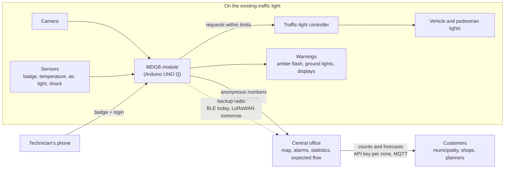

- **Signalised crossings**: MDGB does not replace the controller, it sends *requests* (extend pedestrian green, hold
  vehicle red, immediate red, flashing beacon). The controller applies them only within fixed limits it owns.
  **Fail-safe = the controller's normal cycle**: no added risk compared to today.
- **Crossings without a traffic light**: MDGB drives its own beacon; there the fail-safe is a flashing amber.
- **In the prototype** the controller is simulated in the sketch of the microcontroller, and the traffic light is the
  three LEDs of the model.

### Design principles

1. **Safety does not depend on Linux or on the AI.** The rule runs on Linux, but the microcontroller keeps the
   traffic light safe on its own: without a heartbeat for 0.5 s it cancels every request.
2. **An explicit rule, not a black box.** The decision is a state machine with physical formulas (stopping
   distance, time to collision). Every command carries a human-readable `reason` with the numbers that produced it.
3. **Privacy by design.** Frames are never written to disk; only anonymous metadata leaves the device; the live view
   is behind badge + login and can be switched off for production.
4. **Offline first.** Decisions are local; data waits on disk until the central office confirms it.
5. **No data loss.** Every event is stored before being sent and marked sent only after a positive acknowledgement
   (*measured*: 100 s network cut, 0 events lost, 0 duplicates).
6. **Graceful degradation.** Camera covered or dazzled, vision stopped, network down, sensor silent: each case has a
   defined, safe behaviour and is shown to the technician with what to do.

---

## 4. Stakeholders

| Stakeholder | What they need | What MDGB gives them |
|---|---|---|
| **Vulnerable pedestrians** (elderly, children, people with reduced mobility, visually impaired) | Enough time to cross, to be seen | Green extended to their real speed, held red, warnings to drivers |
| **All pedestrians and cyclists** | Safety without waiting longer than needed | Requests only for who needs them; no change for others |
| **Drivers** | Clear, timely warnings; no useless stops | Amber flash and speed on the display only when it matters |
| **Municipality, traffic department** (the customer) | Safer crossings, evidence for investments, low cost | Retrofit device, near-miss and give-way data, flows by hour |
| **Local police, road-safety observatories** | Facts on dangerous spots | Anonymous incidents and near misses with time and place |
| **Maintenance technicians** | Know quickly what is broken and how to fix it | Technician page with the status of every part and "what to do"; remote diagnosis at the central office |
| **Traffic-light and controller manufacturers** | New value on installed equipment | An add-on that talks to their controller through requests |
| **Commercial activities, urban planners** | Footfall and time patterns | Counts, expected flow and 24-hour forecasts of the cameras in their zone, through an API key (paid service) |
| **Privacy authority, citizens** | No surveillance | No images stored, metadata only, live view only for authenticated staff |
| **GOMA, HackTurin** | A credible, working prototype | Demo on the real board with measured numbers |

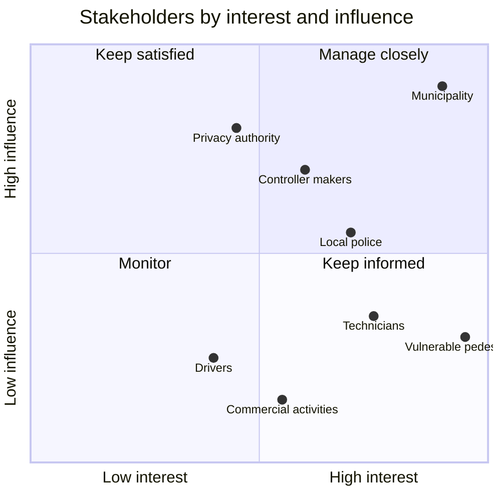

---

## 5. System overview

### The whole system as a graph

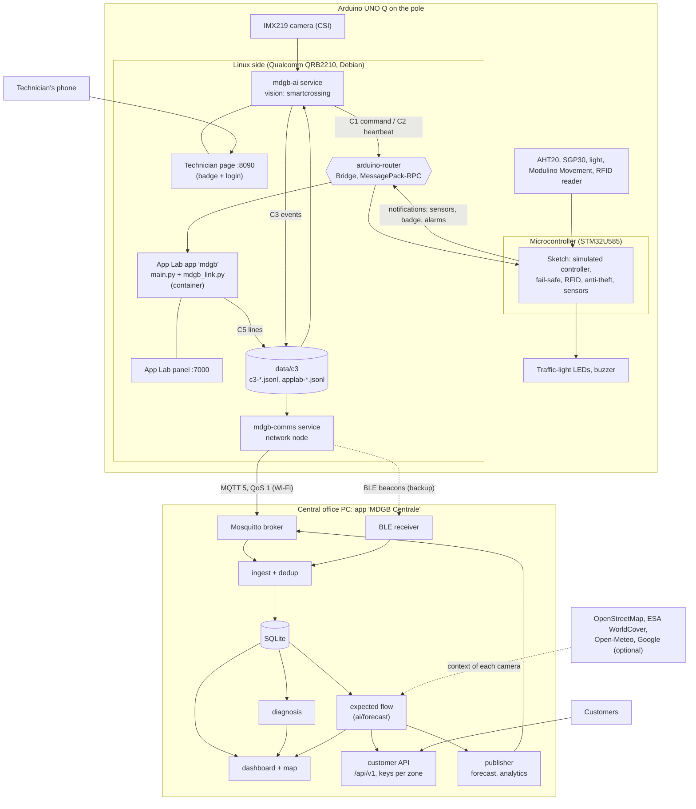

### Who runs what on the board

| Process | Where | Owner | What it does |
|---|---|---|---|
| Sketch | microcontroller | Salvatore (firmware) | Simulated controller with fixed limits, fail-safe on missing heartbeat, RFID with lockout, anti-theft (accelerometer), sensors every 500 ms, buzzer muted while a technician works |
| App Lab app `mdgb` | Linux, App Lab container | Salvatore, with Lorenzo's `mdgb_link.py` | Receives the sketch notifications, writes them as C5 lines for the network and the vision; panel on port 7000 |
| `mdgb-ai` | Linux, systemd service | Paolo (AI) | Camera, detection, tracking, rule, commands to the sketch, events, technician page on port 8090 |
| `mdgb-comms` | Linux, systemd service | Lorenzo (communications) | Store and forward, MQTT uplink, BLE backup with hysteresis |
| `arduino-router` | Linux, system service | Arduino | Bridge between Linux processes and the microcontroller |

Why separate processes: the App Lab container has no access to Bluetooth (so the network runs outside it), the AI
needs its own Python environment (onnxruntime, supervision), and **if one process stops the others keep going**:
if the vision stops, the light falls back and the network still empties its queue; if the network stops, safety is
unchanged.

### The contracts between the parts

All formats are in [`docs/CONTRACTS.md`](CONTRACTS.md), version 1. Rule: new **optional** fields can be added
without a new version; readers ignore fields they do not know.

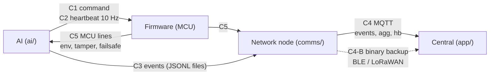

| ID | From → to | Transport | Example |
|---|---|---|---|
| C1 | AI → firmware: command | Bridge `mdgb_line` (serial on other boards) | `{"v":1,"seq":1842,"state":"WARN_DRIVER","req":{"ped_green_extend_s":7,"veh_red_hold":true,"veh_red_now":false,"flash":false},"tech":false,...}` |
| C2 | AI → firmware: heartbeat | same, every 100 ms | `{"v":1,"hb":1843}` |
| C3 | AI → network: events | JSONL files, one per hour | `{"v":1,"ts":...,"type":"crossing","track_id":12,"cls":"pedestrian","dir":"in","line":"ped"}` |
| C4 | node → central | MQTT 5, QoS 1 | topics `mdgb/<node>/events`, `agg`, `hb` |
| C4-B | node → central, backup | BLE beacons (LoRaWAN in production) | binary `AGG` 26 bytes, `HB` 12 bytes, alarms 5 bytes |
| C5 | firmware → Linux | Bridge / files of `mdgb_link.py` | `{"v":1,"src":"mcu","type":"tamper","code":3}` |
| Data out | central → customers and other systems | HTTP `/api/v1/...` with API key; MQTT `mdgb/<node>/forecast`, `analytics` (retained) | [`docs/DATA_API.md`](DATA_API.md); new interfaces, the C1–C5 contracts do not change |

---

## 6. Key workflows

### 6.1 From a frame to a decision

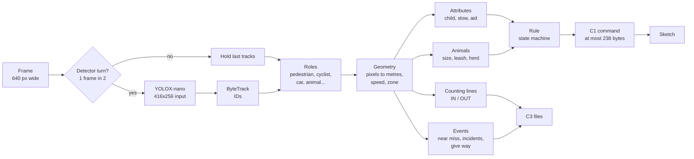

### 6.2 The rule: an explicit state machine

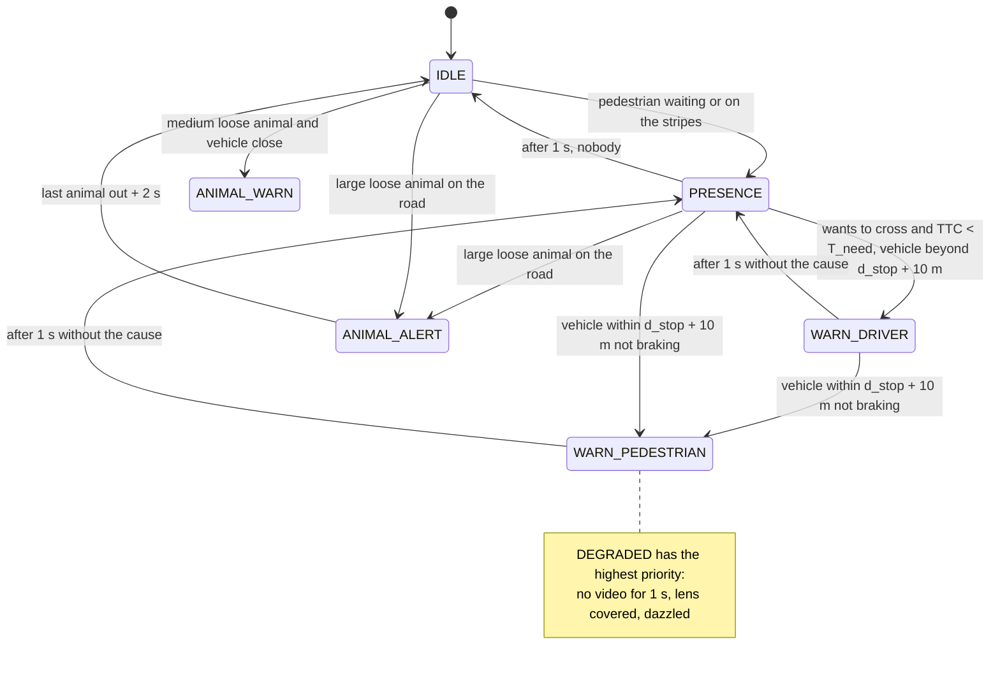

Priority when several apply: `DEGRADED > WARN_PEDESTRIAN > ANIMAL_ALERT > WARN_DRIVER > ANIMAL_WARN > PRESENCE > IDLE`.
A state goes up at once and comes down only after 1 s, so the lamps do not flicker.

| State | Lamp | Driver display (LCD) | Pedestrian display (OLED) |
|---|---|---|---|
| `IDLE` | off | | |
| `PRESENCE` | white on | `PEDONE / IN ATTESA` | green time |
| `WARN_DRIVER` | amber flashing 2 Hz | `PEDONE 47 km/h / RALLENTA` | `ATTENDI auto 45km/h` |
| `WARN_PEDESTRIAN` | red ground lights flashing | `FRENA! 47 km/h / PEDONE` | `FERMO! auto 45km/h` |
| `ANIMAL_WARN` / `ANIMAL_ALERT` | amber 2 Hz / 4 Hz | animals on the road | |
| `DEGRADED` | yellow fail-safe | | |

The pedestrian display **never** invites to cross: the AI does not know the phase of the traffic light.

### 6.3 The traffic light in the sketch: requests within limits

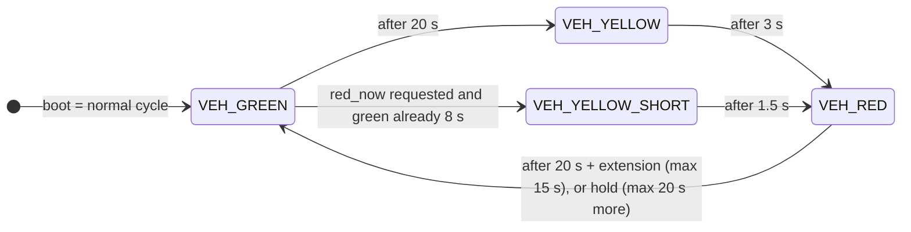

| Limit (constant in the sketch, Linux cannot change it) | Value |
|---|---|
| Vehicle green in the normal cycle | 20 s |
| Minimum vehicle green, even for an urgent red | 8 s |
| Yellow / short yellow before an urgent red | 3 s / 1.5 s |
| Vehicle red (pedestrian green) in the normal cycle | 20 s |
| Maximum pedestrian green extension | 15 s |
| Maximum extra red hold | 20 s |
| Heartbeat timeout → fail-safe | 500 ms |

### 6.4 Example: an elderly pedestrian and a fast car

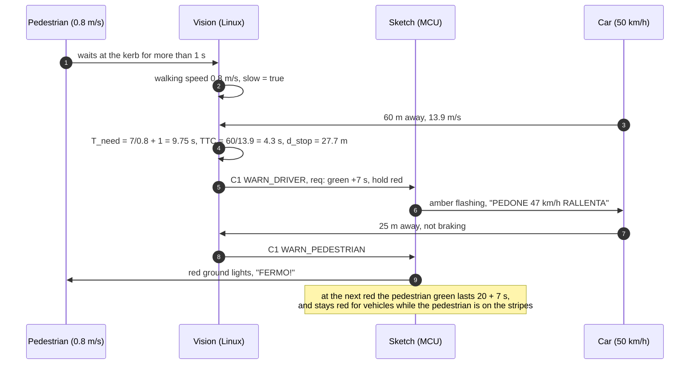

These are the numbers of the automated test in `ai/tests/test_rules.py`.

### 6.5 Fail-safe: the vision stops

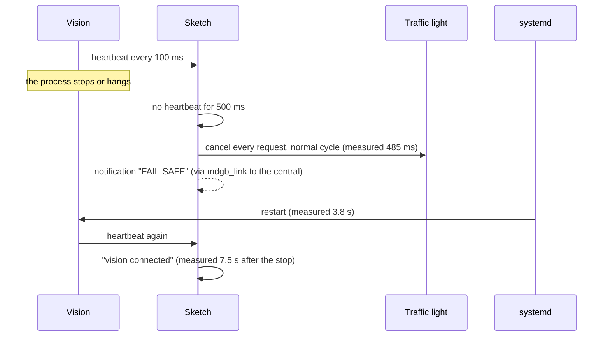

The heartbeat is sent by a separate thread **only while the vision loop is alive**: a frozen loop also stops the
heartbeat, so the sketch never trusts a vision that is no longer thinking.

### 6.6 From an event to the central office, without losses

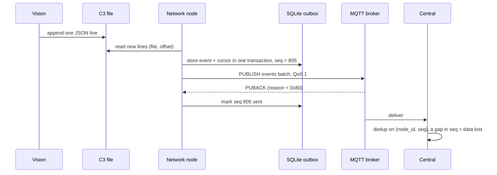

### 6.7 Network down: failover with hysteresis

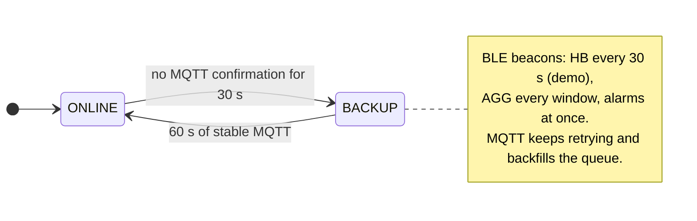

*Measured on the board:* network cut for 100 s → central shows "network down, node healthy" via Bluetooth (−41 dBm)
→ back on Wi-Fi 18 s after the network returns → queue 0, **0 events lost, 0 duplicates**.

### 6.8 The technician at the crossing

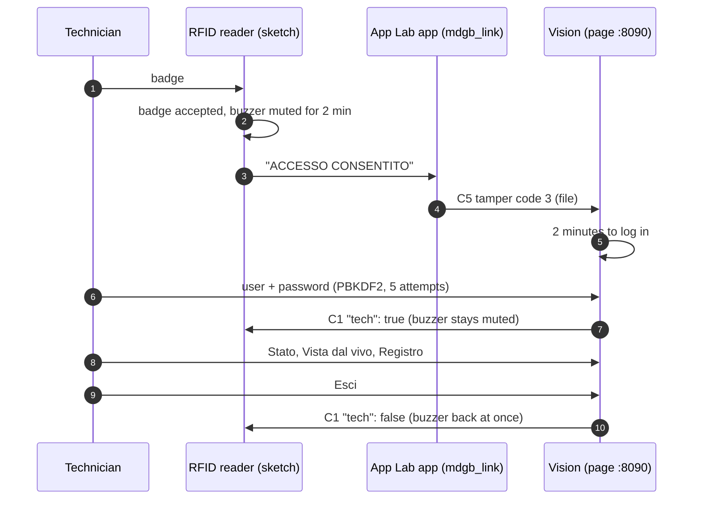

### 6.9 How the central office reads a node

| MQTT heartbeat in the last 30 s | Backup message in the last 11 min | Last information | Diagnosis |
|---|---|---|---|
| yes | — | mode normal | node OK |
| yes or no | yes or no | mode degraded / fail-safe, or `FAULT` | node faulty (with code) |
| no | yes | mode normal | network down, node healthy |
| no | no | `DEAD` received | Linux stuck, MCU alive |
| no | no | `TAMPER` in the last 10 min | tampering (probable) |
| no | no | battery low or falling | battery empty (probable) |
| no | no | nothing | node destroyed or without power |

### 6.10 From counts to expected flow and customers

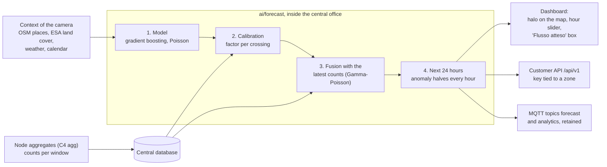

A camera that sends no data still gets the estimate of the model alone; as soon as counts arrive, the estimate follows
them. Details in [§7.11](#711-expected-flow-at-the-central-office) and [§8.9](#89-data-for-customers-api-keys-and-mqtt).

---

## 7. AI and computer vision in detail

Code: [`ai/smartcrossing/`](../ai/smartcrossing). The same Python code runs on a PC and on the UNO Q. All thresholds
are in [`ai/config.yaml`](../ai/config.yaml); decisions and their reasons in [`ai/DECISIONS.md`](../ai/DECISIONS.md).

### 7.1 Model and runtime

| Choice | Why |
|---|---|
| **YOLOX-nano**, COCO, ONNX (Apache-2.0) | Small, free licence, runs everywhere; no torch or ultralytics at runtime (weight, AGPL licence) |
| **onnxruntime**, CPU, 3 threads | The UNO Q has no NPU; the fourth core is left to camera, tracker and the rest |
| Input with the shape of the image (`match_aspect`): 416x256 instead of 320x320 | Same pixels, no padding wasted: about twice the people found at the same cost |
| Region of interest (`roi` in `calib.json`) | The detector looks only at stripes and approach: objects appear larger |
| Detector on every frame (`detect_every_n: 1`, since 11 Oct; before 1 in 2) | 5.9 full analyses per second instead of 4.2: with the fixed tracking it counts many more crossings (§7.9) |
| A dynamic-shape copy of the official model (`make_dynamic_model.py`) | The official file declares 416 px fixed; the network has no fixed size inside |

Classes kept: person, bicycle, car, motorcycle, bus, truck, dog, cat, horse, sheep, cow, bear, bird.

### 7.2 Tracking

`supervision.ByteTrack`. After testing 13 videos the detector hands the tracker every box above 0.10
(`model.conf`), so ByteTrack's second association works, and the matching tolerance is 0.9; new tracks are still
born only from boxes above 0.4. Height and class votes use only boxes above 0.30 (`tracking.measure_min_conf`).
Result: median track duration at night from 0.8 to 1.7 s; vehicles counted on the Turin video from 20+5 to 23+10.
A track is valid after 5 frames on a PC, after 2 at 10 FPS on the board (5 frames would be half a second: a car
would pass the line before counting).

Fixes of 11 Oct ([`ai/DECISIONS.md`](../ai/DECISIONS.md), point 47): supervision's ByteTrack dropped the tracks of
fast objects from its output (tracked but never counted); now every track comes out with the box it was matched with;
boxes are compared enlarged by 50% (buffered IoU, from the C-BIoU tracker); the counting line remembers the side of a
hidden object (behind a pole) for 30 detections instead of 4.

### 7.3 From pixels to metres: calibration and geometry

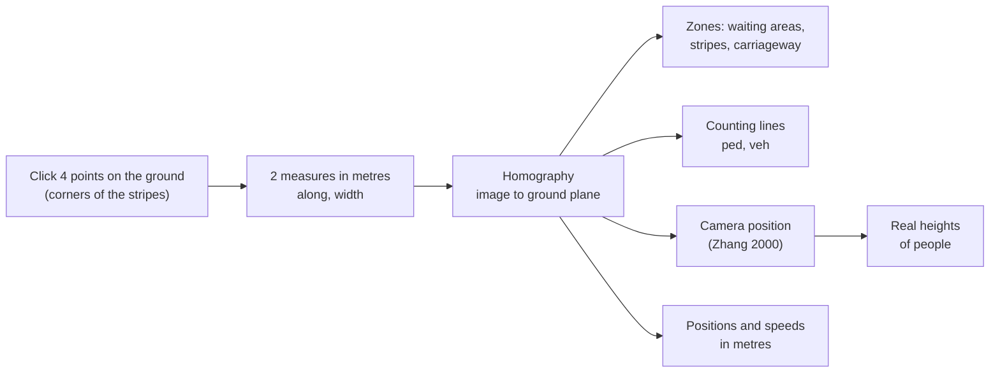

- Measures without a tape: Italian zebra stripes are 50 cm wide with 50 cm gaps (D.P.R. 495/1992, art. 145), so
  counting stripes gives the road width.
- The script reconstructs the camera and checks the calibration fits a real camera (`camera_tolerance` 0.2):
  swapped corners or wrong measures are rejected.
- Speeds are measured over a 0.5 s window with an EMA over 5 samples; not for boxes cut by the image border, not where
  a pixel is worth more than 0.5 m, not for impossible jumps (ID switches).

### 7.4 Attributes of a pedestrian

| Attribute | How | Decided |
|---|---|---|
| `child` | Median height over 5 frames below 1.30 m, from the reconstructed camera; only if the calibration fits and the box is at least 30 px tall | once per track |
| `slow` | Net progress over the last 2 s below 0.9 m/s while walking (people waiting still are not "slow") | once per track |
| `aid` | Optional ONNX classifier on 96x96 crops (wheelchair, walking aid, stroller); without the file it stays unknown and the system works anyway | vote over 3–5 crops |

No age estimation and no face analysis: **the system measures how a person moves, not who they are.**

### 7.5 The rule in numbers

| Quantity | Formula |
|---|---|
| Stopping distance | `d_stop = v·1.0 + v²/(2·7.0)` (1 s reaction, 7 m/s² braking) |
| Time the pedestrian needs | `T_need = W / v_ped + 1.0` |
| Time to collision | `TTC = d / v` |
| Pedestrian speed `v_ped` | 1.2 m/s; 0.8 for child, slow, aid, or seen only by the thermal camera; the measured speed if lower |
| Pedestrian green | `green_s = min(25, max(W/1.2, W/v_ped) + 2)` |

What it asks the traffic light (`req` in C1), and only in two cases:

| Who is there | Request |
|---|---|
| Someone who needs more time (`slow` or `aid`) | longer pedestrian green (up to 15 s), vehicle red held while they are on the stripes |
| An unaccompanied child (no adult within 2 m) or a loose medium/large animal on the road | immediate red for vehicles (after a short yellow), held while they are there |

Anybody else, or a child with an adult, does not change the cycle.

### 7.6 Counting, events, animals

- **Counting**: two lines from the calibration (`ped` along the stripes, `veh` across the lane); the bottom-centre point
  of the box must stay 3 frames beyond the line; each track counts at most once per direction and line.
- **Roles**: a cyclist is a person over a bicycle (IoU > 0.3, person above); the ridden bicycle is not counted.

| Event | Rule (trajectories only, no video model) |
|---|---|
| `near_miss` | vehicle heading to a pedestrian/animal with TTC < 1 s, or both passing the same point within 1 s (PET) |
| `incident` collision | two tracks within 1 m, both stopped, one was above 3 m/s less than 1.5 s before |
| `incident` person down | box wider than tall (> 1.2) for more than 3 s on the carriageway |
| `incident` hard brake | deceleration above 6 m/s² |
| `incident` vehicle on crosswalk | stopped on the stripes for more than 10 s |
| `yield` | with a pedestrian waiting, did the vehicle slow below 2 m/s before the stripes? (give-way rate) |
| `status` | every 5 s: state, FPS, ms per phase, counts |

**Animals**: size from the calibration (large ≥ 0.8 m long or ≥ 0.6 m tall). A large loose animal on the road →
`ANIMAL_ALERT` even without vehicles; a dog on a leash (person within 2 m, same direction) raises no alarm of its
own; a herd keeps the alert until the last animal leaves, plus 2 s. Site profiles `urbano`, `lungofiume`, `collina`.
No sound towards animals.

### 7.7 Night: thermal camera (optional)

Grove MLX90621, 16x4 pixels, looking along the kerb: each column is a slice of pavement. At night (image mean
brightness below 50 for 5 s), heat in a waiting zone with no person seen by the camera for 0.5 s becomes an
"unclassified pedestrian" treated as vulnerable (0.8 m/s). A person seen by the camera without heat is flagged, not
ignored: when in doubt, protect. Tested in simulation, not yet on the real sensor.

### 7.8 Self-check and the technician

- **Camera self-check**: variance of the Laplacian below 4 = lens covered; more than 50% saturated pixels = dazzled;
  confirmed only if repeated. No video for more than 1 s → `DEGRADED`.
- **Technician page** (port 8090): badge, then user and password within 2 minutes (PBKDF2 hash, 5 attempts). Three
  tabs: *Stato* (one sentence on top, then what to fix with "what to do", then one line per working part), *Vista dal
  vivo* (stream opened only in that tab), *Registro* (accesses, alarms, crossings, checks; downloadable).
- **Check of the parts** (`health.py`, once a second): camera, recognition, link to the sketch, App Lab app and
  sketch, temperature/humidity, air, light, anti-theft, badge reader, event file. Every change also goes to the
  service log.

### 7.9 Performance (measured on the Arduino UNO Q, 10–11 Oct 2026)

| Setting | detect | total per frame | FPS |
|---|---|---|---|
| 320 px, 4 threads, detector every frame | 148 ms | 172 ms | 5.8 |
| 256 px, 3 threads | 95 ms | 114 ms | 8.8 |
| **320 px, 3 threads, detector 1 frame in 2 (profile `unoq`)** | 139 ms | 82 ms on average | **12.3** |
| Real camera (IMX219), profile `unoq` | 129 ms | | **9.2** end-to-end |

Specification target: at least 8 FPS. Reference points for the same board: YOLOv8n at 640 px with OpenCV DNN 1–2 FPS.

**Since 11 Oct** the `unoq` profile analyses every frame: measured on the board with a video as the source, 5.9 FPS all
analysed against 8.4 FPS of which 4.2 analysed (to be measured again with the camera). Fewer FPS, more crossings counted.

**How well it counts** ([`ai/docs/BENCHMARK.md`](../ai/docs/BENCHMARK.md), in Italian): 8 videos from a still camera,
compared with a much larger model (YOLOX-l at 960 px) checked by eye.

| | Real crossings | Counted until 10 Oct | Counted since 11 Oct |
|---|---:|---:|---:|
| Pedestrians | 23 | 9 | **13 (57%)** |
| Cyclists | 4 | 0 | **2** |
| Vehicles | 77 | 24 | **47 (61%)** |

Right direction in 100% of cases and no false or double counts. Where the camera sees the line well: 17 out of 17. The
misses are in the Turin videos shot from a balcony (a pole hides the line, people 15 pixels tall).

### 7.10 Known limits

- Dense crowds: only part of the pedestrians are detected; counts in those scenes are not reliable.
- With the board limits the far direction of vehicles was barely counted on some videos: it was the tracker, fixed
  on 11 Oct (§7.2).
- People under 20 pixels tall (far crossings) are missed: the camera has to be mounted close to the crossing.
- Small bicycles and scooters are often missed, so riders are counted as pedestrians.
- Heights (and `child`) depend on a good calibration: to be verified with a person of known height on the real camera.
- The aid classifier is not trained yet: wheelchairs and walkers are recognised only through slow walking.

### 7.11 Expected flow at the central office

Code: [`ai/forecast/`](../ai/forecast/README.md) (owner Paolo), run **inside the central office app**, not on the
board. For every camera on the map it estimates pedestrians in, pedestrians out, cyclists and vehicles per hour, now
and for each of the next 24 hours. The runtime uses only the Python standard library (the trained trees are read from
`model.json`); numpy and scikit-learn are needed only to retrain.

| Step | How | Numbers |
|---|---|---|
| 1. Model | Gradient boosting, one per class, Poisson loss, 17 variables (calendar, Italian holidays, nearby places, land cover, weather) | Expected count per 15-minute window |
| 2. Calibration | How much this crossing deviates from what its context predicts | One factor per class, 0.05–20, close to 1 while counts are few |
| 3. Fusion | Latest node windows correct the current estimate (Gamma-Poisson) | Model weighs as 10 expected passages; a window 30 min old weighs half; windows are added until 80 passages are expected; if the counts contradict the model (10×) the model loses weight at once |
| 4. Next hours | From the current estimate back to the calibrated model | Whatever is unusual now halves every hour |

**Sources of context.** Only the coordinates of the camera are sent out; answers are cached on disk and refreshed in
the background, so without internet the last good answer is used, and without any source only the calendar.

| Source | Gives | Key |
|---|---|---|
| OpenStreetMap (Overpass, fallback to the official API) | bars, shops, stops, schools, leisure within 300 m; road class | no |
| ESA WorldCover 10 m (2021) | share of built-up, green, water within 300 m (partial HTTP reads of the public tiles) | no |
| Open-Meteo | temperature and rain for the next 30 hours | no |
| Google Places, Google Routes | reviews and opening hours; traffic ratio | yes (optional, not yet tried with a real key) |
| The node itself (C4 `agg`) | measured counts and temperature | — |

**Check of the estimate.** Every window already counted is re-estimated with only the data available before it
started, and compared with two references: repeating the last count, and the model alone. On invented counts
(Poisson around a known rhythm), mean error in pedestrians per window:

| Situation | Mean per window | MDGB estimate | Repeat the last | Model only |
|---|---|---|---|---|
| Crowded, 15-min windows | 90.5 | 15.1 | 13.9 | 40.6 |
| Crowded, flat counts day and night | 128.0 | 12.9 | 13.0 | 78.2 |
| Quiet, 15-min windows | 4.1 | 1.9 | 2.6 | 3.1 |

Where passages are many the estimate is as good as repeating the last count; where they are few it is better. Training
on 180 simulated crossings and testing on 60 unseen ones, the model explains 56–60% of the deviance for pedestrians and
73% for vehicles, against 31–37% for a weekly profile.

**Limits, to say in the pitch.** The training history is **simulated** (there are no historical counts at the
hackathon): the numbers show the method, not real measures, and every API answer says so. Neither Google nor the
satellites count pedestrians: they give context. The in/out split comes only from the node counts.

---

## 8. Communications engineering in detail

Code: [`comms/`](../comms) (on the board) and [`app/`](../app) (central office). Formats:
[`docs/CONTRACTS.md`](CONTRACTS.md).

### 8.1 Principles

- **Safety stays on the board.** The network carries data only; if it falls, the traffic light works the same.
- **Data is never lost.** Store before sending, mark sent only on a positive acknowledgement.
- **The node stays visible.** When Wi-Fi fails a backup radio keeps the central office informed.
- **No fake data on the board.** The node reads only real events; without BlueZ it refuses to start.

### 8.2 MQTT uplink

| Parameter | Value |
|---|---|
| Protocol | MQTT 5, QoS 1 everywhere, `clean_start=false`, session expiry 3600 s, keepalive 30 s, reconnect backoff 1–30 s |
| Client ID | `node_id` (e.g. `nodo01`) |
| Topics | `mdgb/<node>/events` (batches of 1–50 events), `mdgb/<node>/agg` (exact windows), `mdgb/<node>/hb` (every 10 s, retained, with Last Will), `mdgb/<node>/backup` (remote receivers) |
| Confirmation | PUBACK with reason code < 0x80; ≥ 0x80 means not sent, event stays in the queue |
| "Online" | only if confirmations arrived in the last 30 s, not just because TCP is connected |
| Demo broker | Mosquitto inside the central app on the PC, port 1883, local network, no TLS |
| Production broker | MQTT 5 in the cloud, mutual TLS on 8883, one X.509 certificate per node (revocable) |

The idea at the start was AWS IoT Core; without AWS credits the demo uses a local broker. The code is the same:
only the `MQTT_*` settings change.

### 8.3 Store and forward

- Every C3/C5 line becomes an event in SQLite **before** any send, together with the read cursor (file, offset) in
  the same transaction: no loss and no duplicates even if the node restarts.
- `seq`: persistent integer, never reused; `event_id = <node_id>-<seq>` (`nodo07-000805`). The central office
  deduplicates on `(node_id, seq)` and a gap in `seq` is data lost.
- Aggregates (`agg`) are computed from the events on disk, in fixed windows (60 s demo, 900 s production), so they are
  exact even for windows that matured during a blackout.
- Retention: up to 2,000,000 events; only the oldest already-sent ones are deleted.

### 8.4 Backup radio

| | Demo | Production |
|---|---|---|
| Radio | Bluetooth Low Energy of the UNO Q (`btmgmt` advertising) | LoRaWAN, Wio-E5 on the MCU UART, EU868, OTAA, class A |
| Range | 10–50 m to the PC | kilometres to a gateway |
| What | alarms at once, heartbeat, aggregates; never single events | same |
| Format | 27-byte frame in the Manufacturer Specific Data (company ID 0xFFFF), up to 3 beacons in rotation | fPort = type, payload = body |

Binary messages (little-endian): `AGG` 26 bytes (window, pedestrians in/out, cyclists, vehicles, animals,
vulnerable, near misses, incidents, give-way rate, temperature, humidity, light, backlog, battery), `HB` 12 bytes
(mode, state, backlog, battery, free disk, minutes without MQTT), alarms 5 bytes (`TAMPER`, `INCIDENT`, `FAULT`:
timestamp + code). 26 bytes is the maximum of a legacy BLE advertising and fits LoRaWAN EU868 even at SF12 (51
bytes); one `AGG` every 15 min and one `HB` every 5 min stay well within the 1% duty cycle.

### 8.5 The Bridge between Linux and the microcontroller

- `arduino-router` service, MessagePack-RPC over `unix:///var/run/arduino-router.sock`; on Linux the official
  `arduino-router-bridge` library (the same App Lab uses), so it also works from a normal venv or a systemd service.
- `mdgb_line`: exposed by the sketch with `provide_safe` (runs inside `loop()`, no race with LEDs and controller);
  takes one C1 or C2 line, returns true if valid.
- **Found on the board**: the router refuses calls longer than **238 bytes**, while the contract said 512. The
  `Commander` now fits every command: first it shortens `reason`, then drops `oled`, `lcd`, `led`, `green_s`, `t_ms`;
  `v`, `seq`, `state`, `req` and `tech` always stay. Measured: the full 366-byte line was refused, the 234-byte one
  accepted.
- Each function exposed with `provide` belongs to one process only; never call the Bridge inside a provided function
  (deadlock risk).

### 8.6 App Lab and the network

The Python of App Lab runs in a Docker container that cannot use the board's Bluetooth. So the network is a service on
the board's Linux, and the App Lab app passes the sketch's data through files: `mdgb_link.py` writes C5 lines in
`/app/data/c3/applab-*.jsonl` (that is `~/ArduinoApps/mdgb/data/c3` on the board), the same folder where the vision
writes its C3 events and where both the network and the vision read.

| The sketch sends | The central office gets |
|---|---|
| temperature/humidity, light, air (every 500 ms) | `env` every 10 s |
| anti-theft alarm | `tamper` code 1, at most one every 10 s |
| badge accepted | `tamper` code 3 (information, not an alarm) |
| "FAIL-SAFE" | `failsafe`, also when the vision is off |

### 8.7 The central office: "MDGB Centrale"

- One desktop app (macOS and Windows), a single file: Python, libraries, dashboard and the Mosquitto broker inside.
  Built with PyInstaller; the Windows build runs on GitHub Actions.
- Inside: broker → `ingest.py` (dedup, lost-event count) → SQLite → `diagnosis.py` → dashboard (Flask) with a vector map
  (MapLibre + OpenFreeMap, free, no key; schematic map offline). BLE receiver (`bleak`) writes straight into the same
  database, without internet.
- Shows: map of nodes coloured by status, channel (Wi-Fi or Bluetooth with signal), queue, battery, traffic per
  window, safety (give way, near misses, vulnerable pedestrians), alarms, and the network numbers: events received,
  **events lost (must stay 0)**, duplicates discarded.
- **Expected flow** (§7.11): a halo around every camera grows with the pedestrians expected in the hour chosen on a
  slider above the map (now to +24 h); the camera detail has the four numbers of that hour, a 24-hour chart and the
  sources used. It works also for a camera that sends no data.
- **Data for customers** (§8.9): a card at the bottom of the page creates API keys; `customers.py` does the same from
  the terminal; `publisher.py` sends estimates and metrics on MQTT every `ANALYTICS_PERIOD_S` seconds (30 by default).
- Map pins for the nodes in four status colours are in [`docs/brand/mappa/`](brand/mappa).

### 8.8 Security and privacy of the data path

| | Demo | Production |
|---|---|---|
| Transport | local Wi-Fi, no encryption | TLS, one certificate per node |
| Content | anonymous metadata only | same |
| Images | live view only on the board, behind badge + login, never saved | `operator.share_images: false`: no image leaves the vision |
| Technician page | HTTP on the local network | HTTPS needed |
| Customer API | listens only on the central office PC unless `WEB_HOST=0.0.0.0`; key in a header, stored as SHA-256 | HTTPS proxy that forwards only `/api/v1/` |
| Forecast and analytics topics | broker open to the local network, no password | broker users with read-only access per customer |

### 8.9 Data for customers: API keys and MQTT

Formats and examples: [`docs/DATA_API.md`](DATA_API.md) (new interfaces written by Paolo, to be reviewed by Lorenzo;
the C1–C5 contracts do not change). Only counts per crossing leave the central office: never images, single events or
identifiers of people.

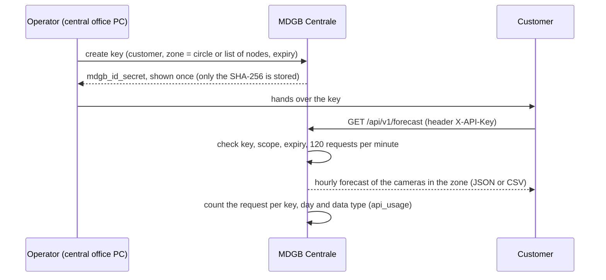

| Address | Scope | Returns |
|---|---|---|
| `GET /api/v1/zone` | any | the zone of the key, its cameras, the expiry |
| `GET /api/v1/realtime` | `realtime` | per camera: last window, last hour, current estimate per hour with an 80% interval; zone total |
| `GET /api/v1/forecast?hours=24` | `forecast` | hour-by-hour forecast per camera and for the zone; CSV with `&format=csv` |
| `GET /api/v1/history?hours=24` | `realtime` | the counted windows, up to 24 hours; CSV available |
| `GET /api/v1/metrics` | `realtime` | traffic and safety metrics of the last 24 hours, and the check of the estimate |

Errors: 401 (key missing, unknown, expired or revoked), 403 (scope not included), 429 (more than 120 requests in a
minute). A zone with no camera yet answers `"available": false` and fills in by itself when a camera is installed.

On MQTT the central office publishes every 30 s, per camera, `mdgb/<node>/forecast` (current estimate and next 24
hours, with an `anomaly` level normal/high/low) and `mdgb/<node>/analytics` (metrics), QoS 1 and retained. These topics
are separate from the ones the nodes publish, so they never re-enter the ingest.

The `api_usage` table is the metering base for a paid data service (§11).

---

## 9. Firmware and hardware

### 9.1 The sketch (microcontroller)

- **Simulated controller** with the limits of §6.3, constants that Linux cannot change.
- **Fail-safe**: more than 500 ms without heartbeat → requests cancelled, normal cycle; at boot the normal cycle until
  the first heartbeat.
- **RFID badge** with lockout (3rd error 1 min, 4th 5 min, 5th 15 min); the badge code lives in `arduino_secrets.h`,
  never in the repository.
- **Anti-theft**: total acceleration outside 0.65–1.15 g → alarm, buzzer (muted while a technician works).
- **Sensors** every 500 ms: Modulino Movement, AHT20, SGP30, light sensor.
- No `delay()`: buzzer, lockout and traffic light run together.

### 9.2 App Lab apps

| App | What | When |
|---|---|---|
| `firmware/unoq_panel` (`mdgb-pannello.zip`) | Sketch + `main.py` + `mdgb_link.py` + technician panel on port 7000; vision as a separate service | the board as deployed today |
| `firmware/unoq_mcu` (`mdgb.zip`) | Everything inside App Lab, vision included | only if the `mdgb-ai` service is disabled (the camera can be opened by one program only) |

Both are built with `python firmware/tools/build_applab_zip.py [--panel]`.

### 9.3 Hardware

| Part | Use |
|---|---|
| Arduino UNO Q 4 GB | Linux (vision, network) + microcontroller (safety) |
| Media Carrier + Sony IMX219 camera (CSI) | vision; opened with `libcamerify` |
| Grove Base Shield (3.3 V), AHT20, SGP30, light sensor, Modulino Movement, RFID reader, buzzer | sensors and anti-theft |
| LEDs of the model (prototype); WS2813 strips and ring planned | traffic light and warnings |
| LCD 16x2 and OLED (planned) | texts for drivers and pedestrians |
| MLX90621 thermal camera (optional) | night presence |

Notes for production: LED strips on a separate 5 V supply with common ground; a second, non-visual safety path (PIR,
ToF) read directly by the microcontroller; lamp monitoring with a current sensor (±30% → fault). Full list and
priorities in [`hardware/BOM.md`](../hardware/BOM.md).

---

## 10. Testing and validation

| What | How | Result |
|---|---|---|
| AI | `pytest` in `ai/` (rule values of the specification, counting without duplicates, geometry, events, animals, thermal, technician page, health) | 194 tests passing on 11 Oct (2 fail only on Windows: file permissions and file-name order) |
| Network and central | `pytest comms` (real node on real files, Wi-Fi off/on, negative PUBACK, Bridge with the official library against a fake router) | 41 tests |
| Expected flow | `pytest` on `ai/tests/test_forecast*.py` (model, fusion, sources with a local HTTP server, cache, calendar, metrics, check of the estimate) | 80 tests passing (re-run on Windows, Python 3.11, 11 Oct) |
| Central: flow and customer API | `pytest comms/tests/test_dashboard.py comms/tests/test_customers.py` (keys, zones, permissions, rate limit, CSV, MQTT messages) | 29 tests passing (same run); the JavaScript of the map was tested by hand |
| Vision on the board | camera, profile `unoq` | 9.2 FPS (10 Oct, detector 1 frame in 2); since 11 Oct detector on every frame, 5.9 FPS on a video |
| Counting against a reference | `ai/scripts/benchmark.py`, 8 still-camera videos, disagreements checked by eye | pedestrians 13/23, cyclists 2/4, vehicles 47/77; right direction 100%, 0 double counts |
| Kill test, vision | stop the vision | fail-safe after 485 ms; systemd restart 3.8 s; "vision connected" after 7.5 s |
| Kill test, network | 100 s MQTT cut | Bluetooth backup at −41 dBm; back on Wi-Fi in 18 s; 0 lost, 0 duplicates |
| Urgent red via Bridge | request while green had been on for 5 s | yellow at 8.0 s (minimum green), short yellow 1.5 s, red held while requested |
| Commands on the Bridge | 366-byte line vs fitted 234-byte line | refused / accepted |
| Automatic start | board reboot | vision, network and App Lab app restart by themselves |

Still to test on the real hardware: badge → login → muted buzzer from a phone; a request born from a real scene (needs
the calibration of the real crossing); thermal camera; LED strips and displays.

Demo checklist (from the specification): day and night video with correct counts; elderly pedestrian + fast car
(`WARN_DRIVER` then `WARN_PEDESTRIAN` with the reason visible); kill test of the vision; kill test of the network;
extended green and held red on the model; loose animal vs dog on a leash; FPS, ms per phase, give-way rate and near
misses on screen; "no frame saved" said in the pitch.

---

## 11. Business plan (draft)

> **Draft for discussion.** Prices and volumes below are *assumptions* to frame the pitch, not validated figures.
> Market data and public procurement rules must be checked before using them outside the team.

### 11.1 Value proposition

| For | Value |
|---|---|
| Municipality | Safer crossings without roadworks; evidence (near misses, give way) to decide where to invest; open data |
| Vulnerable pedestrians | Time to cross measured on them, not on an average walker |
| Maintenance | Remote diagnosis and a technician page that says what to fix |
| Commercial activities, planners | Anonymous flows by hour and day and 24-hour forecasts for the crossings in their zone, through an API key |

### 11.2 Business model

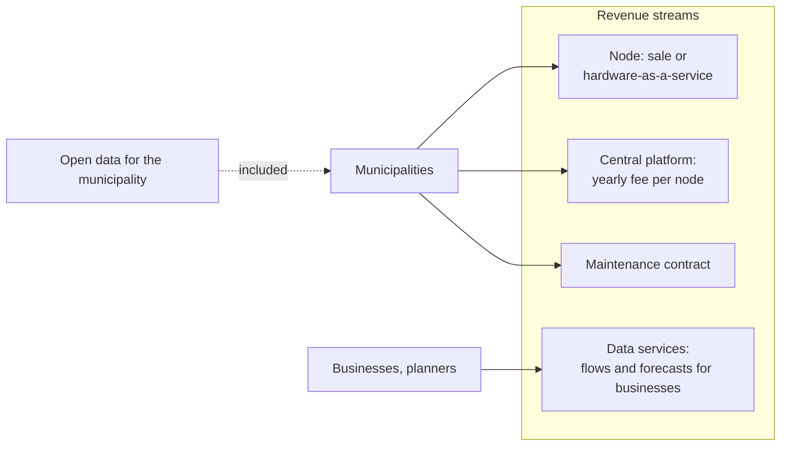

| Stream | Customer | Assumption to validate |
|---|---|---|
| Node (one-off or leasing) | Municipality | Industrialised node with enclosure, mounting, power and radio: target well below the cost of a new "smart" crossing |
| Central platform | Municipality | Yearly fee per node: broker, storage, dashboard, updates |
| Maintenance | Municipality | Remote diagnosis lowers the cost of every visit |
| Data services | Commercial activities, planners | Footfall by hour and forecasts per zone; open data stays free for the municipality. Already in the prototype: keys per customer and zone, scopes, expiry, revocation and usage counted per key and day (§8.9). Prices and terms of use still to define |

### 11.3 Reference costs

| Item | Figure | Source |
|---|---|---|
| Prototype device (components) | about 150–250 € | team estimate, [`hardware/BOM.md`](../hardware/BOM.md) |
| "Smart" crossing, Cislago (VA), 2020 | 6,500 € | [Saronno News](https://saronnonews.it/2020/07/14/cislago-in-via-cesare-battisti-arriva-il-pedone-smart/?output=pdf) |
| Three luminous crossings, Rubiera (RE) | about 15,000 € (≈ 5,000 € each) | [il Resto del Carlino](https://www.ilrestodelcarlino.it/reggio-emilia/cronaca/nuove-strisce-pedonali-con-i-ec7ba691) |
| Luminous crossings, Palermo | about 250,000 € over 50 streets | [Balarm](https://www.balarm.it/news/se-passi-si-illuminano-a-palermo-arrivano-le-strisce-pedonali-intelligenti-ecco-dove-155045) |
| Smart crossings, Como | about 16,700 € per crossing, as quoted in the BOM | *not verified*: the pilot is real ([Espansione TV](https://www.espansionetv.it/2024/12/20/como-tutelare-i-pedoni-e-ridurre-gli-incidenti-arrivano-i-nuovi-attraversamenti-pedonali-luminosi)), the amount was not found |

Those systems mostly detect presence and light up the crossing. MDGB adds understanding of the scene, requests to the
controller, counting and data, on the traffic light that is already there.

### 11.4 Go to market

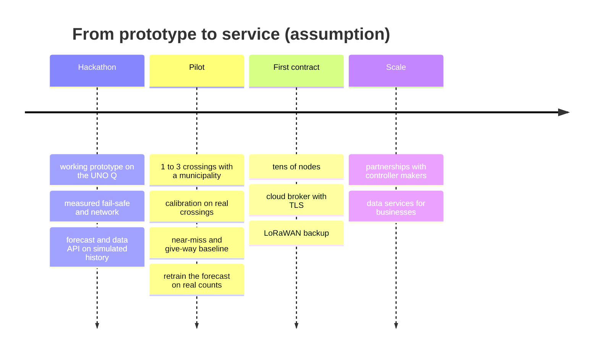

- **Pilot first**: a few dangerous crossings (schools, elderly centres) chosen with the traffic department; measure
  before/after (give-way rate, near misses, extended greens granted).
- **Channels**: public tenders and procurement platforms for public administrations; partnership with traffic-light and
  controller makers, so the request interface is integrated in their controllers.
- **Funding**: road-safety funding lines for municipalities *(to be verified case by case)*.

### 11.5 KPIs

Give-way rate, near misses per 1,000 crossings, extended greens granted to vulnerable pedestrians, urgent reds,
uptime of the node, **events lost (target 0)**, time to fail-safe (target < 0.5 s), technician interventions avoided
thanks to remote diagnosis; for the data service, forecast error against "repeat the last count" and API requests per
customer.

### 11.6 Risks and mitigations

| Risk | Mitigation |
|---|---|
| Approval to act on traffic lights (road regulations, controller certification) | Requests only, inside limits owned by the certified controller; fail-safe = normal cycle |
| Privacy (GDPR, AI Act) | No image stored, metadata only, live view behind authentication and switchable off; no biometric identification |
| False alarms or missed detections | Explicit rule with logged reasons; graceful degradation; second non-visual safety path (PIR/ToF) planned |
| Vandalism, theft | Anti-theft accelerometer, tamper events to the central office, enclosure |
| Weather, night | Self-check of the camera, thermal camera option, sensors for fogging (humidity) |
| Connectivity | Offline decisions, store and forward, radio backup |
| Liability | MDGB never removes protection that exists today; every decision has a recorded reason |

---

## 12. Roadmap

| Area | Next steps |
|---|---|
| AI | Calibration on the real crossing; aid classifier (wheelchair, walker, stroller); thermal camera on the real sensor; better far-vehicle and bicycle detection |
| Firmware | LED strips and ring, LCD and OLED; second safety path (PIR, ToF); lamp monitoring (current sensor); hardware watchdog |
| Communications | Cloud broker with mutual TLS; LoRaWAN backup with the `DEAD` watchdog; contract v1 update (`tech`, `veh_red_now`, 238-byte Bridge limit) |
| Data | Expected flow and customer API are on `main` (§7.11, §8.9). Next: retrain on real aggregates, try the Google sources with a real key, opening hours from OpenStreetMap, archive beyond 24 hours, HTTPS and MQTT users for customers, prices |
| Product | Enclosure, power with backup battery, installation guide, HTTPS for the technician page |
| Stretch | V2X: "hidden pedestrian at X m" broadcast to vehicles |

---

## 13. Pitch outline

A suggested 10-slide structure built on this document:

1. **Hook**: 470 pedestrians killed in Italy in 2024; the most exposed need the most time (§2).
2. **The problem**: crossings sized for the average walker, presence sensors that do not understand (§2).
3. **MDGB**: a guardian on the existing traffic light (§3, concept diagram).
4. **Live demo**: elderly pedestrian + fast car, then loose animal vs dog on a leash (§6.4, §7.6).
5. **Safety first**: requests within limits, fail-safe in 485 ms (§6.3, §6.5).
6. **Privacy by design**: no image saved, metadata only, technician behind badge + login (§3, §8.8).
7. **Never loses data**: network cut, Bluetooth backup, 0 events lost (§6.7).
8. **Under the hood**: local AI on an Arduino UNO Q, every frame analysed; crossings always counted in the right
   direction and without double counts (§7.9); explicit rule (§7).
9. **Business**: retrofit vs new smart crossings, revenue streams, the data service already working (halo map,
   API keys per zone), pilot (§11, §8.9).
10. **Team and next steps** (§12).

---

## 14. Glossary, repository map, sources

### Glossary

| Term | Meaning |
|---|---|
| C1…C5 | The messages between the parts, defined in [`docs/CONTRACTS.md`](CONTRACTS.md) |
| Fail-safe | Behaviour without the vision: normal cycle (signalised) or flashing amber (unsignalised) |
| Heartbeat | Message every 100 ms that says "the vision is alive" |
| TTC | Time to collision: distance / speed |
| PET | Post-encroachment time: time between two road users passing the same point |
| `d_stop` | Distance a vehicle needs to stop |
| `T_need` | Time a pedestrian needs to cross |
| Give-way rate | Share of vehicles that slow down for a waiting pedestrian |
| Store and forward | Save every event before sending it, delete only after confirmation |
| Bridge | The RPC link between Linux and the microcontroller of the UNO Q |
| App Lab | Arduino's environment for apps that combine a sketch and Python on the UNO Q |
| Expected flow | Passages per hour that the central office expects at a camera, from a model corrected with the node counts |
| API key, zone | Credential of a data customer, valid for the cameras inside a circle on the map or a list of nodes |

### Repository map

| Path | What | Owner |
|---|---|---|
| [`ai/`](../ai/README.md) | vision, rule, technician page | Paolo Malugani |
| [`ai/forecast/`](../ai/forecast/README.md) | expected flow, run by the central office | Paolo Malugani |
| [`firmware/`](../firmware/unoq_panel/README.md) | App Lab apps, sketch | Salvatore Gullotta |
| [`comms/`](../comms/README.md) | network node | Lorenzo Dragoni |
| [`app/`](../app/README.md) | central office app | Lorenzo Dragoni |
| [`hardware/`](../hardware/BOM.md) | components, power | Kuzey Bicher |
| [`docs/`](CONTRACTS.md) | contracts, [data API](DATA_API.md), brand, this document; English translations in [`docs/en/`](en/README.md) | everyone |

### Sources

- ISTAT and ACI, road accidents 2024: [ACI press release](https://aci.gov.it/comunicati-stampa/aci-istat-gli-incidenti-stradali-2024-nelle-107-province-italiane/),
  [ISTAT provincial data 2024 (PDF)](https://www.istat.it/wp-content/uploads/2025/10/CS_Incidenti-stradali_provinciali_Anno-2024.pdf).
- Smart crossing costs: see §11.3.
- Challenge brief: [`docs/Transcription.txt`](Transcription.txt). Technical specification:
  [`PROMPT_SMART_CROSSING.md`](../PROMPT_SMART_CROSSING.md).
- Zhang, Z. (2000), *A flexible new technique for camera calibration*, IEEE TPAMI.
