

  <picture>
    <source media="(prefers-color-scheme: dark)" srcset="brand/mdgb-logo-scuro.svg">
    
  </picture>

<b>Ogni attraversamento ha un guardiano.</b> 
Documentazione di riferimento: il problema, il sistema, come funziona ogni parte e una prima bozza di business plan.

<a href="MDGB_DOCUMENTATION.md">English version</a>

> **Documento vivo.** Descrive il repository all'11 ottobre 2026 (`main` a `dad00d9`). Diverse parti sono ancora in
> lavorazione: se questo file e il README di un modulo non coincidono, valgono il README e
> [`docs/CONTRACTS.md`](CONTRACTS.md). I numeri indicati come *misurati* vengono da prove sulla scheda vera; quelli
> indicati come *ipotesi* sono stime da verificare.

## Indice

1. [MDGB in una pagina](#1-mdgb-in-una-pagina)
2. [Il problema](#2-il-problema)
3. [La soluzione](#3-la-soluzione)
4. [Stakeholder](#4-stakeholder)
5. [Il sistema](#5-il-sistema)
6. [I flussi principali](#6-i-flussi-principali)
7. [AI e visione artificiale nel dettaglio](#7-ai-e-visione-artificiale-nel-dettaglio)
8. [Comunicazioni nel dettaglio](#8-comunicazioni-nel-dettaglio)
9. [Firmware e hardware](#9-firmware-e-hardware)
10. [Prove e verifiche](#10-prove-e-verifiche)
11. [Business plan (bozza)](#11-business-plan-bozza)
12. [Roadmap](#12-roadmap)
13. [Scaletta del pitch](#13-scaletta-del-pitch)
14. [Glossario, mappa del repository, fonti](#14-glossario-mappa-del-repository-fonti)

---

## 1. MDGB in una pagina

**MDGB (Mobility Data & Guardian Beacon)** è un piccolo modulo che si monta su un semaforo esistente, in
corrispondenza di un attraversamento pedonale. Una camera e un modello di AI che girano **interamente sul
dispositivo** riconoscono chi sta arrivando (pedoni, ciclisti, veicoli, animali) e come si muove. Poi MDGB:

- **protegge**: chiede alla centralina del semaforo più verde per chi cammina piano o usa una carrozzina, trattiene il
  rosso dei veicoli finché è ancora sulle strisce, e chiede il rosso subito quando in strada c'è un bambino non
  accompagnato o un animale libero;
- **avvisa**: ambra lampeggiante verso i conducenti, luci rosse a terra e testi verso i pedoni;
- **conta e misura**: attraversamenti per direzione senza doppioni, quasi incidenti, incidenti, quanto spesso i
  conducenti danno la precedenza;
- **riferisce**: alla centrale arrivano solo numeri anonimi, via Wi-Fi/MQTT, con una radio di backup quando la rete
  cade.

Tre idee lo rendono diverso:

| | |
|---|---|
| **Non rende mai l'attraversamento meno sicuro** | MDGB *chiede* soltanto; la centralina applica una richiesta solo entro limiti fissi. Se MDGB si guasta, il semaforo torna al suo ciclo normale entro 0,5 s (*misurato*: 485 ms). |
| **Pensa in locale** | Per decidere non servono cloud né internet. Circa 9 fotogrammi al secondo su una Arduino UNO Q (*misurato*). |
| **Privacy fin dal progetto** | Nessuna immagine viene mai salvata. Dal dispositivo escono solo metadati. La vista dal vivo esiste solo in memoria, solo per un tecnico che ha passato il badge ed è entrato con utente e password. |

---

## 2. Il problema

### La sfida

La sfida GOMA *Smart Crossing* di HackTurin chiedeva "un attraversamento che comprende ciò che accade": un dispositivo
embedded con visione artificiale e AI **interamente locali** che riconosca pedoni, ciclisti, veicoli, persone con
disabilità e animali vicino a un attraversamento, **attivi una segnalazione luminosa in tempo reale secondo una regola
esplicita**, **conti gli attraversamenti distinguendone la direzione** senza doppioni e **continui a funzionare senza
connessione internet**.

### Perché conta

In Italia nel 2024 sono morti **470 pedoni** e ci sono stati **19.763 incidenti stradali con pedoni coinvolti**, su
3.030 morti sulle strade in totale ([ISTAT/ACI 2024](#fonti)). I pedoni sono il 15,5% dei morti sulle strade. I più
esposti sono quelli a cui serve più tempo: anziani, bambini, persone con mobilità ridotta.

### Cosa non va negli attraversamenti di oggi

| Oggi | Conseguenza | MDGB |
|---|---|---|
| Verde pedonale fisso, tarato su chi cammina a velocità media | Chi cammina piano è ancora in strada quando le auto hanno il verde | Misura la velocità di camminata reale e chiede il tempo che serve davvero |
| Sensori di presenza (PIR, pulsante) che dicono solo "c'è qualcuno" | Luci che lampeggiano per chiunque, o per nessuno (chiamate a vuoto) | Interpreta la scena: chi aspetta e chi passa, l'intenzione di attraversare, la velocità di chi arriva |
| Nessun dato su quasi incidenti e comportamento dei conducenti | Il Comune scopre che un attraversamento è pericoloso solo dopo un incidente | Registra in forma anonima quasi incidenti, quota di precedenze date, incidenti, flussi |
| Analisi video nel cloud | Problemi di privacy, dipendenza dalla rete, costi ricorrenti | Tutto sul dispositivo; escono solo numeri |
| Un nuovo attraversamento "smart" significa nuova infrastruttura | Migliaia di euro ad attraversamento, cantieri | Si aggiunge al semaforo e alla centralina che ci sono già |

Idee raccolte dal team sul campo (file [`idee_crosswalk`](../idee_crosswalk)): *tempo di sgombero dinamico* (il verde
dura quanto l'attraversamento reale), annullare una chiamata pedonale quando la zona d'attesa è vuota, distinguere chi
passeggia sul marciapiede da chi sta per attraversare, proteggere passeggini, cani guida e carrozzine, rilevare veicoli
fermi sulle strisce e persone che cadono.

---

## 3. La soluzione

### L'idea

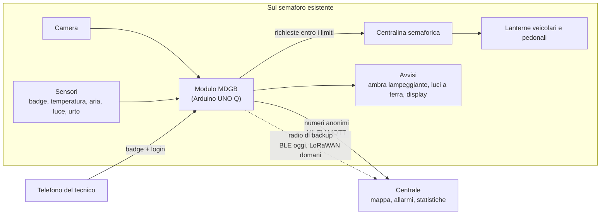

- **Attraversamenti con semaforo**: MDGB non sostituisce la centralina, le manda *richieste* (allungare il verde
  pedonale, trattenere il rosso veicolare, rosso subito, lampeggiante). La centralina le applica solo entro limiti
  fissi che sono suoi. **Fail-safe = il ciclo normale della centralina**: nessun rischio in più rispetto a oggi.
- **Attraversamenti senza semaforo**: MDGB comanda un lampeggiante suo; lì il fail-safe è il giallo lampeggiante.
- **Nel prototipo** la centralina è simulata nello sketch del microcontrollore, e il semaforo sono i tre LED del
  plastico.

### Principi di progetto

1. **La sicurezza non dipende da Linux né dall'AI.** La regola gira su Linux, ma il microcontrollore tiene il semaforo
   sicuro da solo: senza heartbeat per 0,5 s annulla ogni richiesta.
2. **Una regola esplicita, non una scatola nera.** La decisione è una macchina a stati con formule fisiche (distanza
   d'arresto, tempo alla collisione). Ogni comando porta un `reason` leggibile con i numeri che l'hanno prodotto.
3. **Privacy fin dal progetto.** I fotogrammi non vengono mai scritti su disco; dal dispositivo escono solo metadati
   anonimi; la vista dal vivo è dietro badge e login e in produzione si può spegnere.
4. **Prima di tutto offline.** Le decisioni sono locali; i dati aspettano su disco finché la centrale non li conferma.
5. **Nessun dato perso.** Ogni evento si salva prima dell'invio e si segna inviato solo dopo una conferma positiva
   (*misurato*: rete tagliata per 100 s, 0 eventi persi, 0 doppioni).
6. **Degrado controllato.** Camera coperta o abbagliata, visione ferma, rete giù, sensore muto: per ogni caso c'è un
   comportamento sicuro e definito, che viene mostrato al tecnico insieme a cosa fare.

---

## 4. Stakeholder

| Stakeholder | Di cosa ha bisogno | Cosa gli dà MDGB |
|---|---|---|
| **Pedoni vulnerabili** (anziani, bambini, persone con mobilità ridotta, ipovedenti) | Tempo sufficiente per attraversare, essere visti | Verde allungato sulla loro velocità reale, rosso trattenuto, avvisi ai conducenti |
| **Tutti i pedoni e i ciclisti** | Sicurezza senza aspettare più del necessario | Richieste solo per chi ne ha bisogno; per gli altri non cambia nulla |
| **Conducenti** | Avvisi chiari e tempestivi; nessuna fermata inutile | Ambra lampeggiante e velocità sul display solo quando serve |
| **Comune, ufficio traffico** (il cliente) | Attraversamenti più sicuri, dati per decidere gli investimenti, costi bassi | Dispositivo che si aggiunge al semaforo, dati su quasi incidenti e precedenze, flussi per ora |
| **Polizia locale, osservatori sulla sicurezza stradale** | Dati sui punti pericolosi | Incidenti e quasi incidenti anonimi, con ora e luogo |
| **Tecnici della manutenzione** | Capire subito cosa è rotto e come ripararlo | Pagina del tecnico con lo stato di ogni parte e "cosa fare"; diagnosi a distanza in centrale |
| **Produttori di semafori e centraline** | Nuovo valore sugli impianti installati | Un'aggiunta che parla con la loro centralina tramite richieste |
| **Attività commerciali, urbanisti** | Passaggi e andamento orario | Flussi aggregati (servizio a pagamento), previsioni (roadmap) |
| **Garante della privacy, cittadini** | Nessuna sorveglianza | Nessuna immagine salvata, solo metadati, vista dal vivo solo per personale autenticato |
| **GOMA, HackTurin** | Un prototipo credibile e funzionante | Demo sulla scheda vera con numeri misurati |

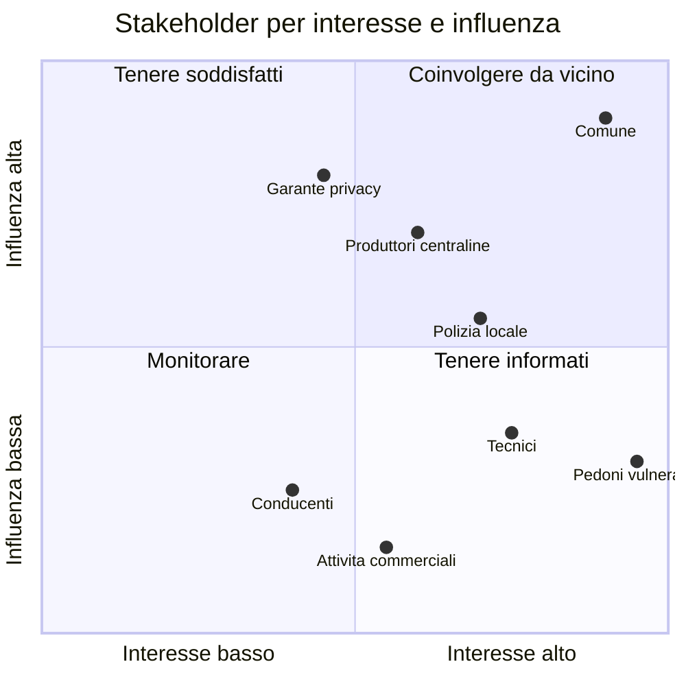

---

## 5. Il sistema

### Tutto il sistema come grafo

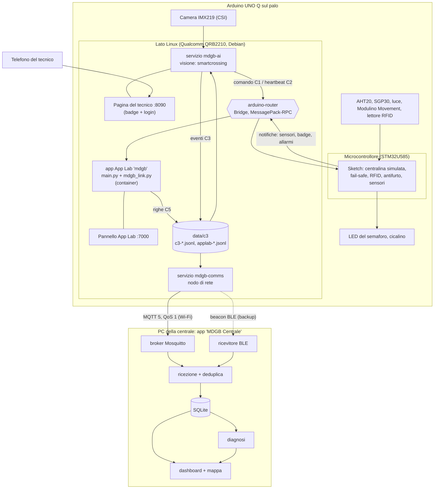

### Chi fa cosa sulla scheda

| Processo | Dove | Owner | Cosa fa |
|---|---|---|---|
| Sketch | microcontrollore | Salvatore (firmware) | Centralina simulata con limiti fissi, fail-safe se manca l'heartbeat, RFID con blocco, antifurto (accelerometro), sensori ogni 500 ms, cicalino muto mentre lavora un tecnico |
| App App Lab `mdgb` | Linux, container di App Lab | Salvatore, con `mdgb_link.py` di Lorenzo | Riceve le notifiche dello sketch e le scrive come righe C5 per la rete e la visione; pannello sulla porta 7000 |
| `mdgb-ai` | Linux, servizio systemd | Paolo (AI) | Camera, rilevamento, tracking, regola, comandi allo sketch, eventi, pagina del tecnico sulla porta 8090 |
| `mdgb-comms` | Linux, servizio systemd | Lorenzo (comunicazioni) | Store and forward, invio MQTT, backup BLE con isteresi |
| `arduino-router` | Linux, servizio di sistema | Arduino | Ponte tra i processi Linux e il microcontrollore |

Perché processi separati: il container di App Lab non può usare il Bluetooth (quindi la rete gira fuori), l'AI ha
bisogno del suo ambiente Python (onnxruntime, supervision) e **se un processo si ferma gli altri continuano**: se si
ferma la visione, il semaforo torna al ciclo normale e la rete continua a svuotare la coda; se si ferma la rete, la
sicurezza non cambia.

### I contratti tra le parti

Tutti i formati sono in [`docs/CONTRACTS.md`](CONTRACTS.md), versione 1. Regola: si possono aggiungere campi nuovi
**opzionali** senza cambiare versione; chi legge ignora i campi che non conosce.

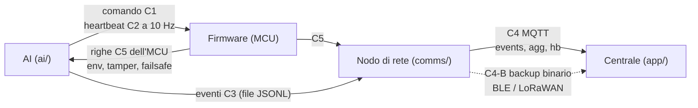

| ID | Da → a | Trasporto | Esempio |
|---|---|---|---|
| C1 | AI → firmware: comando | Bridge `mdgb_line` (seriale su altre schede) | `{"v":1,"seq":1842,"state":"WARN_DRIVER","req":{"ped_green_extend_s":7,"veh_red_hold":true,"veh_red_now":false,"flash":false},"tech":false,...}` |
| C2 | AI → firmware: heartbeat | lo stesso, ogni 100 ms | `{"v":1,"hb":1843}` |
| C3 | AI → rete: eventi | file JSONL, uno all'ora | `{"v":1,"ts":...,"type":"crossing","track_id":12,"cls":"pedestrian","dir":"in","line":"ped"}` |
| C4 | nodo → centrale | MQTT 5, QoS 1 | topic `mdgb/<nodo>/events`, `agg`, `hb` |
| C4-B | nodo → centrale, backup | beacon BLE (LoRaWAN in produzione) | binari: `AGG` 26 byte, `HB` 12 byte, allarmi 5 byte |
| C5 | firmware → Linux | Bridge / file di `mdgb_link.py` | `{"v":1,"src":"mcu","type":"tamper","code":3}` |

---

## 6. I flussi principali

### 6.1 Da un fotogramma a una decisione

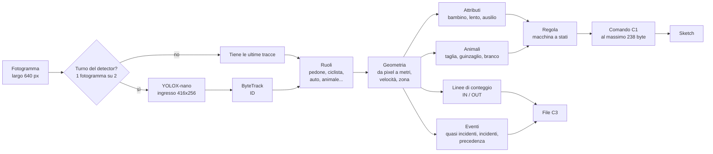

### 6.2 La regola: una macchina a stati esplicita

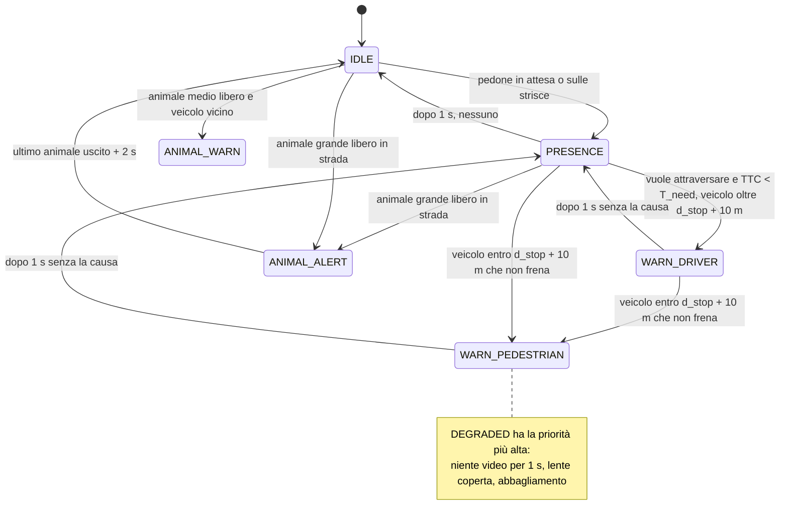

Priorità quando ne valgono più d'uno: `DEGRADED > WARN_PEDESTRIAN > ANIMAL_ALERT > WARN_DRIVER > ANIMAL_WARN > PRESENCE > IDLE`.
Uno stato sale subito e scende solo dopo 1 s, così le lampade non tremolano.

| Stato | Lampada | Display conducenti (LCD) | Display pedoni (OLED) |
|---|---|---|---|
| `IDLE` | spenta | | |
| `PRESENCE` | bianco fisso | `PEDONE / IN ATTESA` | tempo di verde |
| `WARN_DRIVER` | ambra lampeggiante 2 Hz | `PEDONE 47 km/h / RALLENTA` | `ATTENDI auto 45km/h` |
| `WARN_PEDESTRIAN` | luci rosse a terra lampeggianti | `FRENA! 47 km/h / PEDONE` | `FERMO! auto 45km/h` |
| `ANIMAL_WARN` / `ANIMAL_ALERT` | ambra 2 Hz / 4 Hz | animali in strada | |
| `DEGRADED` | giallo di fail-safe | | |

Il display dei pedoni **non** invita mai ad attraversare: l'AI non conosce la fase del semaforo.

### 6.3 Il semaforo nello sketch: richieste entro i limiti

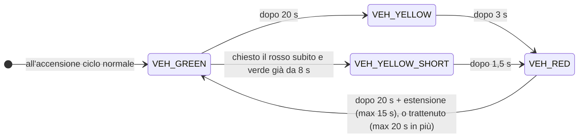

| Limite (costante nello sketch, Linux non può cambiarlo) | Valore |
|---|---|
| Verde veicoli nel ciclo normale | 20 s |
| Verde veicoli minimo, anche per un rosso d'urgenza | 8 s |
| Giallo / giallo breve prima di un rosso d'urgenza | 3 s / 1,5 s |
| Rosso veicoli (verde pedonale) nel ciclo normale | 20 s |
| Estensione massima del verde pedonale | 15 s |
| Rosso trattenuto in più al massimo | 20 s |
| Heartbeat assente → fail-safe | 500 ms |

### 6.4 Esempio: un pedone anziano e un'auto veloce

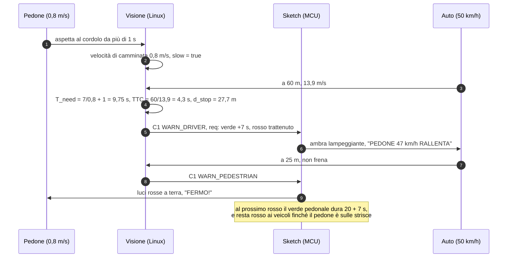

Sono i numeri del test automatico in `ai/tests/test_rules.py`.

### 6.5 Fail-safe: la visione si ferma

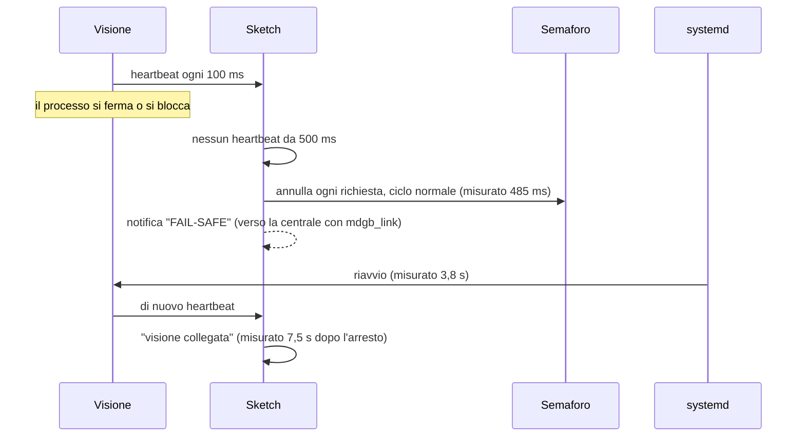

L'heartbeat parte da un thread separato **solo finché il ciclo della visione è vivo**: se il ciclo si blocca si ferma
anche l'heartbeat, così lo sketch non si fida mai di una visione che non sta più ragionando.

### 6.6 Da un evento alla centrale, senza perdite

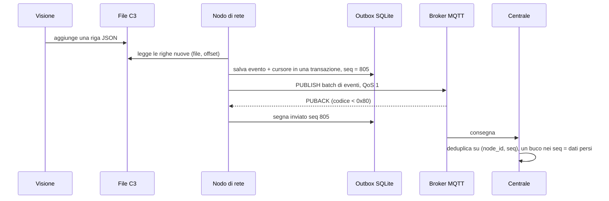

### 6.7 Rete giù: failover con isteresi

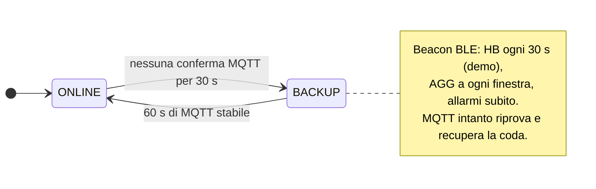

*Misurato sulla scheda:* rete tagliata per 100 s → la centrale mostra "rete giù, nodo sano" via Bluetooth (−41 dBm) →
di nuovo su Wi-Fi 18 s dopo il ritorno della rete → coda a 0, **0 eventi persi, 0 doppioni**.

### 6.8 Il tecnico all'attraversamento

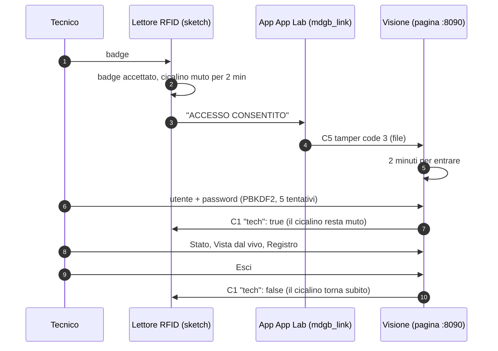

### 6.9 Come la centrale legge un nodo

| Heartbeat MQTT negli ultimi 30 s | Messaggio di backup negli ultimi 11 min | Ultima informazione | Diagnosi |
|---|---|---|---|
| sì | — | modalità normale | nodo OK |
| sì o no | sì o no | modalità degradata / fail-safe, oppure `FAULT` | nodo guasto (con il codice) |
| no | sì | modalità normale | rete giù, nodo sano |
| no | no | ricevuto `DEAD` | Linux bloccato, MCU vivo |
| no | no | `TAMPER` negli ultimi 10 min | manomissione (probabile) |
| no | no | batteria bassa o in calo | batteria scarica (probabile) |
| no | no | nessun preavviso | nodo distrutto o senza alimentazione |

---

## 7. AI e visione artificiale nel dettaglio

Codice: [`ai/smartcrossing/`](../ai/smartcrossing). Lo stesso codice Python gira su PC e sulla UNO Q. Tutte le soglie
sono in [`ai/config.yaml`](../ai/config.yaml); le decisioni e i loro motivi in [`ai/DECISIONS.md`](../ai/DECISIONS.md).

### 7.1 Modello ed esecuzione

| Scelta | Perché |
|---|---|
| **YOLOX-nano**, COCO, ONNX (Apache-2.0) | Piccolo, licenza libera, gira ovunque; niente torch né ultralytics a runtime (peso, licenza AGPL) |
| **onnxruntime**, CPU, 3 thread | La UNO Q non ha NPU; il quarto core resta a camera, tracker e al resto |
| Ingresso con la forma dell'immagine (`match_aspect`): 416x256 invece di 320x320 | Stessi pixel, nessun bordo sprecato: circa il doppio delle persone trovate allo stesso costo |
| Zona d'interesse (`roi` in `calib.json`) | Il detector guarda solo strisce e strada prima: gli oggetti appaiono più grandi |
| Detector su 1 fotogramma su 2 (`detect_every_n: 2`), tracker su tutti | Da 5,8 a 12,3 FPS sul video di prova; conta meglio che scendere a 256 px |
| Copia a ingresso libero del modello ufficiale (`make_dynamic_model.py`) | Il file ufficiale dichiara 416 px fissi; la rete al suo interno non ha dimensioni fisse |

Classi tenute: person, bicycle, car, motorcycle, bus, truck, dog, cat, horse, sheep, cow, bear, bird.

### 7.2 Tracking

`supervision.ByteTrack`. Dopo le prove su 13 video il detector passa al tracker ogni riquadro sopra 0,10
(`model.conf`), così il secondo aggancio di ByteTrack lavora, e la tolleranza dell'aggancio è 0,9; le tracce nuove
nascono comunque solo da riquadri sopra 0,4. Altezza e voto di classe usano solo i riquadri sopra 0,30
(`tracking.measure_min_conf`). Risultato: durata mediana delle tracce di notte da 0,8 a 1,7 s; veicoli contati sul
video di Torino da 20+5 a 23+10. Una traccia vale dopo 5 fotogrammi su PC, dopo 2 a 10 FPS sulla scheda (5 fotogrammi
sarebbero mezzo secondo: un'auto passerebbe la linea prima di contare).

### 7.3 Da pixel a metri: calibrazione e geometria

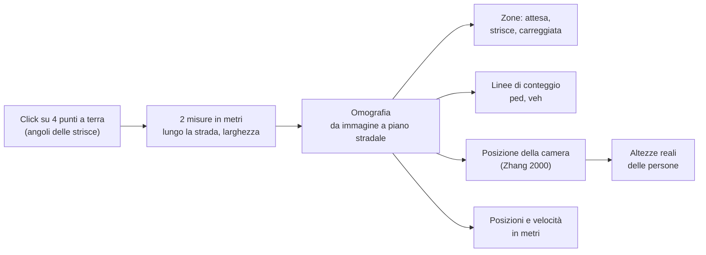

- Misure senza metro: in Italia le strisce pedonali sono larghe 50 cm con 50 cm di intervallo (D.P.R. 495/1992,
  art. 145), quindi contando le strisce si ottiene la larghezza della strada.
- Lo script ricostruisce la camera e controlla che la calibrazione torni con una camera reale (`camera_tolerance` 0,2):
  angoli scambiati o misure sbagliate vengono scartati.
- Le velocità si misurano su una finestra di 0,5 s con un'EMA su 5 campioni; non per i riquadri tagliati dal bordo
  dell'immagine, non dove un pixel vale più di 0,5 m, non per salti impossibili (cambi di ID).

### 7.4 Attributi di un pedone

| Attributo | Come | Deciso |
|---|---|---|
| `child` | Altezza mediana su 5 fotogrammi sotto 1,30 m, dalla camera ricostruita; solo se la calibrazione torna e il riquadro è alto almeno 30 px | una volta per traccia |
| `slow` | Avanzamento netto negli ultimi 2 s sotto 0,9 m/s mentre cammina (chi aspetta fermo non è "lento") | una volta per traccia |
| `aid` | Classificatore ONNX opzionale su ritagli 96x96 (carrozzina, deambulatore, passeggino); senza il file resta sconosciuto e il sistema funziona lo stesso | voto su 3–5 ritagli |

Nessuna stima dell'età e nessuna analisi del volto: **il sistema misura come una persona si muove, non chi è.**

### 7.5 La regola in numeri

| Grandezza | Formula |
|---|---|
| Distanza d'arresto | `d_stop = v·1,0 + v²/(2·7,0)` (reazione 1 s, frenata 7 m/s²) |
| Tempo che serve al pedone | `T_need = W / v_ped + 1,0` |
| Tempo alla collisione | `TTC = d / v` |
| Velocità del pedone `v_ped` | 1,2 m/s; 0,8 per bambino, lento, con ausilio o visto solo dalla termocamera; quella misurata se più bassa |
| Verde pedonale | `green_s = min(25, max(W/1,2, W/v_ped) + 2)` |

Cosa chiede al semaforo (`req` in C1), e solo in due casi:

| Chi c'è | Richiesta |
|---|---|
| Chi ha bisogno di più tempo (`slow` o `aid`) | verde pedonale più lungo (fino a 15 s), rosso dei veicoli trattenuto finché è sulle strisce |
| Un bambino non accompagnato (nessun adulto entro 2 m) o un animale libero medio/grande in strada | rosso subito ai veicoli (dopo un giallo breve), trattenuto finché sono lì |

Chiunque altro, o un bambino con un adulto, non cambia il ciclo.

### 7.6 Conteggio, eventi, animali

- **Conteggio**: due linee dalla calibrazione (`ped` lungo le strisce, `veh` trasversale alla corsia); il punto in
  basso al centro del riquadro deve restare 3 fotogrammi oltre la linea; ogni traccia conta al massimo una volta per
  verso e per linea.
- **Ruoli**: un ciclista è una persona sopra una bici (IoU > 0,3, persona più in alto); la bici con il suo ciclista non
  si conta.

| Evento | Regola (solo traiettorie, nessun modello video) |
|---|---|
| `near_miss` | veicolo diretto verso un pedone/animale con TTC < 1 s, oppure i due passano dallo stesso punto a meno di 1 s (PET) |
| `incident` collisione | due tracce a meno di 1 m, entrambe ferme, una era sopra 3 m/s meno di 1,5 s prima |
| `incident` persona a terra | riquadro più largo che alto (> 1,2) per più di 3 s in carreggiata |
| `incident` frenata brusca | decelerazione oltre 6 m/s² |
| `incident` veicolo sulle strisce | fermo sulle strisce per più di 10 s |
| `yield` | con un pedone in attesa, il veicolo ha rallentato sotto 2 m/s prima delle strisce? (quota di precedenze) |
| `status` | ogni 5 s: stato, FPS, ms per fase, conteggi |

**Animali**: taglia dalla calibrazione (grande se lungo almeno 0,8 m o alto almeno 0,6 m). Animale grande libero in
strada → `ANIMAL_ALERT` anche senza veicoli; un cane al guinzaglio (persona entro 2 m, stessa direzione) non fa scattare
un allarme suo; un branco tiene l'allerta finché l'ultimo animale esce, più 2 s. Profili di sito `urbano`,
`lungofiume`, `collina`. Nessun suono verso gli animali.

### 7.7 Notte: termocamera (opzionale)

Grove MLX90621, 16x4 pixel, che guarda lungo il cordolo: ogni colonna è una fetta di marciapiede. Di notte (luminosità
media dell'immagine sotto 50 per 5 s), calore in una zona d'attesa senza nessuna persona vista dalla camera per 0,5 s
diventa un "pedone non classificato" trattato come vulnerabile (0,8 m/s). Una persona vista dalla camera senza calore
viene segnalata, non ignorata: nel dubbio si protegge. Provato in simulazione, non ancora sul sensore vero.

### 7.8 Autodiagnosi e tecnico

- **Autodiagnosi della camera**: varianza del Laplaciano sotto 4 = lente coperta; più del 50% di pixel saturi =
  abbagliamento; confermato solo se si ripete. Niente video per più di 1 s → `DEGRADED`.
- **Pagina del tecnico** (porta 8090): badge, poi utente e password entro 2 minuti (impronta PBKDF2, 5 tentativi). Tre
  schede: *Stato* (una frase in cima, poi cosa sistemare con "cosa fare", poi una riga per ogni parte che funziona),
  *Vista dal vivo* (lo stream si apre solo in quella scheda), *Registro* (accessi, allarmi, passaggi, controlli;
  scaricabile).
- **Controllo delle parti** (`health.py`, una volta al secondo): camera, riconoscimento, collegamento con lo sketch, app
  di App Lab e sketch, temperatura e umidità, aria, luce, antifurto, lettore badge, salvataggio eventi. Ogni cambio va
  anche nel log del servizio.

### 7.9 Prestazioni (misurate sulla Arduino UNO Q, 10–11 ottobre 2026)

| Impostazione | rilevamento | totale per fotogramma | FPS |
|---|---|---|---|
| 320 px, 4 thread, detector a ogni fotogramma | 148 ms | 172 ms | 5,8 |
| 256 px, 3 thread | 95 ms | 114 ms | 8,8 |
| **320 px, 3 thread, detector 1 fotogramma su 2 (profilo `unoq`)** | 139 ms | 82 ms in media | **12,3** |
| Camera vera (IMX219), profilo `unoq` | 129 ms | | **9,2** end-to-end |

Obiettivo della specifica: almeno 8 FPS. Riferimenti per la stessa scheda: YOLOv8n a 640 px con OpenCV DNN 1–2 FPS.

### 7.10 Limiti noti

- Folle fitte: viene rilevata solo una parte dei pedoni; i conteggi in quelle scene non sono affidabili.
- Con i limiti della scheda, in alcuni video il verso lontano dei veicoli quasi non si conta.
- Bici piccole e monopattini spesso non vengono rilevati, quindi chi li guida viene contato come pedone.
- Le altezze (e `child`) dipendono da una buona calibrazione: da verificare con una persona di altezza nota sulla camera
  vera.
- Il classificatore degli ausili non è ancora addestrato: carrozzine e deambulatori si riconoscono solo dal camminare
  lento.

---

## 8. Comunicazioni nel dettaglio

Codice: [`comms/`](../comms) (sulla scheda) e [`app/`](../app) (centrale). Formati: [`docs/CONTRACTS.md`](CONTRACTS.md).

### 8.1 Principi

- **La sicurezza resta sulla scheda.** La rete porta solo dati; se cade, il semaforo funziona lo stesso.
- **I dati non si perdono mai.** Si salva prima di inviare, si segna inviato solo con una conferma positiva.
- **Il nodo resta visibile.** Quando il Wi-Fi cade una radio di backup tiene informata la centrale.
- **Niente dati finti sulla scheda.** Il nodo legge solo eventi veri; senza BlueZ si rifiuta di partire.

### 8.2 Invio MQTT

| Parametro | Valore |
|---|---|
| Protocollo | MQTT 5, QoS 1 ovunque, `clean_start=false`, scadenza sessione 3600 s, keepalive 30 s, riconnessione con attesa 1–30 s |
| Client ID | `node_id` (es. `nodo01`) |
| Topic | `mdgb/<nodo>/events` (batch da 1 a 50 eventi), `mdgb/<nodo>/agg` (finestre esatte), `mdgb/<nodo>/hb` (ogni 10 s, retained, con Last Will), `mdgb/<nodo>/backup` (ricevitori remoti) |
| Conferma | PUBACK con codice < 0x80; ≥ 0x80 vuol dire non inviato, l'evento resta in coda |
| "Online" | solo se sono arrivate conferme negli ultimi 30 s, non basta la connessione TCP |
| Broker della demo | Mosquitto dentro l'app della centrale sul PC, porta 1883, rete locale, senza TLS |
| Broker di produzione | MQTT 5 in cloud, TLS mutuo sulla 8883, un certificato X.509 per nodo (revocabile) |

All'inizio l'idea era AWS IoT Core; senza crediti AWS la demo usa un broker locale. Il codice è lo stesso: cambiano
solo le impostazioni `MQTT_*`.

### 8.3 Store and forward

- Ogni riga C3/C5 diventa un evento in SQLite **prima** di qualunque invio, insieme al cursore di lettura (file, offset)
  nella stessa transazione: niente perdite e niente doppioni anche se il nodo si riavvia.
- `seq`: intero persistente, mai riusato; `event_id = <node_id>-<seq>` (`nodo07-000805`). La centrale deduplica su
  `(node_id, seq)` e un buco nei `seq` è un dato perso.
- Gli aggregati (`agg`) si calcolano dagli eventi su disco, in finestre fisse (60 s nella demo, 900 s in produzione),
  quindi sono esatti anche per le finestre maturate durante un blackout.
- Conservazione: fino a 2.000.000 di eventi; si cancellano solo i più vecchi già inviati.

### 8.4 Radio di backup

| | Demo | Produzione |
|---|---|---|
| Radio | Bluetooth Low Energy della UNO Q (advertising con `btmgmt`) | LoRaWAN, Wio-E5 sulla UART dell'MCU, EU868, OTAA, classe A |
| Portata | 10–50 m fino al PC | chilometri fino a un gateway |
| Cosa | allarmi subito, heartbeat, aggregati; mai i singoli eventi | lo stesso |
| Formato | frame da 27 byte nei Manufacturer Specific Data (company ID 0xFFFF), fino a 3 beacon a rotazione | fPort = tipo, payload = corpo |

Messaggi binari (little-endian): `AGG` 26 byte (finestra, pedoni in/out, ciclisti, veicoli, animali, vulnerabili,
quasi incidenti, incidenti, quota di precedenze, temperatura, umidità, luce, coda, batteria), `HB` 12 byte (modalità,
stato, coda, batteria, disco libero, minuti senza MQTT), allarmi 5 byte (`TAMPER`, `INCIDENT`, `FAULT`: ora + codice).
26 byte è il massimo di un advertising BLE classico e sta in LoRaWAN EU868 anche a SF12 (51 byte); un `AGG` ogni 15 min
e un `HB` ogni 5 min stanno ampiamente dentro l'1% di duty cycle.

### 8.5 Il Bridge tra Linux e microcontrollore

- Servizio `arduino-router`, MessagePack-RPC su `unix:///var/run/arduino-router.sock`; su Linux la libreria ufficiale
  `arduino-router-bridge` (la stessa che usa App Lab), quindi funziona anche da un venv normale o da un servizio
  systemd.
- `mdgb_line`: esposta dallo sketch con `provide_safe` (gira dentro `loop()`, niente conflitti con LED e centralina);
  riceve una riga C1 o C2, risponde true se è valida.
- **Scoperto sulla scheda**: il router rifiuta le chiamate più lunghe di **238 byte**, mentre il contratto diceva 512.
  Il `Commander` ora fa stare ogni comando nel limite: prima accorcia `reason`, poi toglie `oled`, `lcd`, `led`,
  `green_s`, `t_ms`; `v`, `seq`, `state`, `req` e `tech` restano sempre. Misurato: la riga completa da 366 byte veniva
  rifiutata, quella da 234 byte accettata.
- Ogni funzione esposta con `provide` appartiene a un solo processo; mai chiamare il Bridge dentro una funzione esposta
  (rischio di deadlock).

### 8.6 App Lab e la rete

Il Python di App Lab gira in un container Docker che non può usare il Bluetooth della scheda. Per questo la rete è un
servizio sul Linux della scheda, e l'app di App Lab le passa i dati dello sketch tramite file: `mdgb_link.py` scrive
righe C5 in `/app/data/c3/applab-*.jsonl` (cioè `~/ArduinoApps/mdgb/data/c3` sulla scheda), la stessa cartella in cui
la visione scrive i suoi eventi C3 e da cui leggono sia la rete sia la visione.

| Lo sketch manda | Alla centrale arriva |
|---|---|
| temperatura/umidità, luce, aria (ogni 500 ms) | `env` ogni 10 s |
| allarme antifurto | `tamper` code 1, al massimo uno ogni 10 s |
| badge accettato | `tamper` code 3 (informazione, non allarme) |
| "FAIL-SAFE" | `failsafe`, anche a visione spenta |

### 8.7 La centrale: "MDGB Centrale"

- Un'app per il computer (macOS e Windows), un solo file: dentro ci sono Python, le librerie, la dashboard e il broker
  Mosquitto. Costruita con PyInstaller; la versione Windows si costruisce su GitHub Actions.
- Dentro: broker → `ingest.py` (deduplica, conteggio degli eventi persi) → SQLite → `diagnosis.py` → dashboard (Flask)
  con mappa vettoriale (MapLibre + OpenFreeMap, gratis, senza chiave; mappa schematica senza internet). Il ricevitore
  BLE (`bleak`) scrive direttamente nello stesso database, senza internet.
- Mostra: mappa dei nodi colorati per stato, canale (Wi-Fi o Bluetooth con il segnale), coda, batteria, traffico per
  finestra, sicurezza (precedenze, quasi incidenti, pedoni vulnerabili), allarmi, e i numeri della rete: eventi
  ricevuti, **eventi persi (deve restare 0)**, doppioni scartati.
- Gli spilli dei nodi per la mappa, nei quattro colori di stato, sono in [`docs/brand/mappa/`](brand/mappa).

### 8.8 Sicurezza e privacy del percorso dei dati

| | Demo | Produzione |
|---|---|---|
| Trasporto | Wi-Fi locale, senza cifratura | TLS, un certificato per nodo |
| Contenuto | solo metadati anonimi | lo stesso |
| Immagini | vista dal vivo solo sulla scheda, dietro badge + login, mai salvata | `operator.share_images: false`: nessuna immagine esce dalla visione |
| Pagina del tecnico | HTTP sulla rete locale | serve HTTPS |

---

## 9. Firmware e hardware

### 9.1 Lo sketch (microcontrollore)

- **Centralina simulata** con i limiti di §6.3, costanti che Linux non può cambiare.
- **Fail-safe**: più di 500 ms senza heartbeat → richieste annullate, ciclo normale; all'accensione ciclo normale fino
  al primo heartbeat.
- **Badge RFID** con blocco (3° errore 1 min, 4° 5 min, 5° 15 min); il codice del badge sta in `arduino_secrets.h`, mai
  nel repository.
- **Antifurto**: accelerazione totale fuori da 0,65–1,15 g → allarme, cicalino (muto mentre lavora un tecnico).
- **Sensori** ogni 500 ms: Modulino Movement, AHT20, SGP30, sensore di luce.
- Niente `delay()`: cicalino, blocco e semaforo vanno insieme.

### 9.2 App di App Lab

| App | Cosa | Quando |
|---|---|---|
| `firmware/unoq_panel` (`mdgb-pannello.zip`) | Sketch + `main.py` + `mdgb_link.py` + pannello del tecnico sulla porta 7000; la visione è un servizio a parte | la scheda come è installata oggi |
| `firmware/unoq_mcu` (`mdgb.zip`) | Tutto dentro App Lab, visione compresa | solo se il servizio `mdgb-ai` è disattivato (la camera la può aprire un solo programma) |

Entrambe si costruiscono con `python firmware/tools/build_applab_zip.py [--panel]`.

### 9.3 Hardware

| Parte | Uso |
|---|---|
| Arduino UNO Q 4 GB | Linux (visione, rete) + microcontrollore (sicurezza) |
| Media Carrier + camera Sony IMX219 (CSI) | visione; si apre con `libcamerify` |
| Grove Base Shield (3,3 V), AHT20, SGP30, sensore di luce, Modulino Movement, lettore RFID, cicalino | sensori e antifurto |
| LED del plastico (prototipo); strip e ring WS2813 previsti | semaforo e avvisi |
| LCD 16x2 e OLED (previsti) | testi per conducenti e pedoni |
| Termocamera MLX90621 (opzionale) | presenza di notte |

Note per la produzione: strip LED con alimentazione 5 V separata e massa in comune; un secondo percorso di sicurezza
non visivo (PIR, ToF) letto direttamente dal microcontrollore; monitoraggio della lampada con un sensore di corrente
(±30% → guasto). Elenco completo e priorità in [`hardware/BOM.md`](../hardware/BOM.md).

---

## 10. Prove e verifiche

| Cosa | Come | Risultato |
|---|---|---|
| AI | `pytest` in `ai/` (valori della regola della specifica, conteggio senza doppioni, geometria, eventi, animali, termocamera, pagina del tecnico, controllo delle parti) | 186 test passano (2 falliscono solo su Windows: permessi dei file e ordine dei nomi dei file) |
| Rete e centrale | `pytest comms` (nodo vero su file veri, Wi-Fi spento/riacceso, PUBACK negativo, Bridge con la libreria ufficiale contro un router finto) | 41 test |
| Visione sulla scheda | camera, profilo `unoq` | 9,2 FPS |
| Kill test della visione | visione fermata | fail-safe dopo 485 ms; riavvio di systemd 3,8 s; "visione collegata" dopo 7,5 s |
| Kill test della rete | MQTT tagliato per 100 s | backup Bluetooth a −41 dBm; di nuovo su Wi-Fi in 18 s; 0 persi, 0 doppioni |
| Rosso d'urgenza via Bridge | richiesta con il verde acceso da 5 s | giallo a 8,0 s (verde minimo), giallo breve 1,5 s, rosso trattenuto finché richiesto |
| Comandi sul Bridge | riga da 366 byte contro riga accorciata da 234 byte | rifiutata / accettata |
| Avvio automatico | riavvio della scheda | visione, rete e app di App Lab ripartono da sole |

Ancora da provare sull'hardware vero: badge → login → cicalino muto dal telefono; una richiesta nata da una scena vera
(serve la calibrazione dell'attraversamento vero); termocamera; strip LED e display.

Checklist della demo (dalla specifica): video di giorno e di notte con conteggi corretti; pedone anziano + auto veloce
(`WARN_DRIVER` poi `WARN_PEDESTRIAN` con il motivo visibile); kill test della visione; kill test della rete; verde
allungato e rosso trattenuto sul plastico; animale libero contro cane al guinzaglio; FPS, ms per fase, quota di
precedenze e quasi incidenti a schermo; "nessun fotogramma salvato" detto nel pitch.

---

## 11. Business plan (bozza)

> **Bozza da discutere.** Prezzi e volumi qui sotto sono *ipotesi* per impostare il pitch, non dati verificati. Dati di
> mercato e regole degli appalti pubblici vanno controllati prima di usarli fuori dal team.

### 11.1 Proposta di valore

| Per | Valore |
|---|---|
| Comune | Attraversamenti più sicuri senza cantieri; dati (quasi incidenti, precedenze) per decidere dove investire; open data |
| Pedoni vulnerabili | Tempo per attraversare misurato su di loro, non su chi cammina a velocità media |
| Manutenzione | Diagnosi a distanza e una pagina del tecnico che dice cosa sistemare |
| Attività commerciali, urbanisti | Flussi anonimi per ora e giorno, e previsioni |

### 11.2 Modello di business

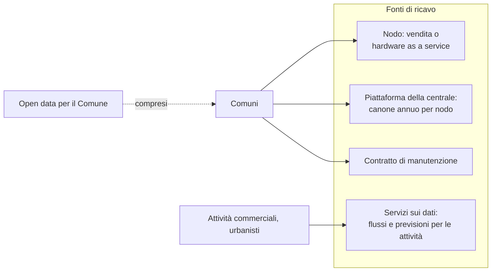

| Fonte | Cliente | Ipotesi da verificare |
|---|---|---|
| Nodo (una tantum o noleggio) | Comune | Nodo industrializzato con case, montaggio, alimentazione e radio: obiettivo ben sotto il costo di un nuovo attraversamento "smart" |
| Piattaforma della centrale | Comune | Canone annuo per nodo: broker, archiviazione, dashboard, aggiornamenti |
| Manutenzione | Comune | La diagnosi a distanza abbassa il costo di ogni intervento |
| Servizi sui dati | Attività commerciali, urbanisti | Passaggi per ora, previsioni; gli open data restano gratuiti per il Comune |

### 11.3 Costi di riferimento

| Voce | Cifra | Fonte |
|---|---|---|
| Dispositivo prototipo (componenti) | circa 150–250 € | stima del team, [`hardware/BOM.md`](../hardware/BOM.md) |
| Attraversamento "smart", Cislago (VA), 2020 | 6.500 € | [Saronno News](https://saronnonews.it/2020/07/14/cislago-in-via-cesare-battisti-arriva-il-pedone-smart/?output=pdf) |
| Tre attraversamenti luminosi, Rubiera (RE) | circa 15.000 € (≈ 5.000 € l'uno) | [il Resto del Carlino](https://www.ilrestodelcarlino.it/reggio-emilia/cronaca/nuove-strisce-pedonali-con-i-ec7ba691) |
| Attraversamenti luminosi, Palermo | circa 250.000 € su 50 strade | [Balarm](https://www.balarm.it/news/se-passi-si-illuminano-a-palermo-arrivano-le-strisce-pedonali-intelligenti-ecco-dove-155045) |
| Attraversamenti smart, Como | circa 16.700 € ad attraversamento, come citato nel BOM | *non verificato*: la sperimentazione esiste ([Espansione TV](https://www.espansionetv.it/2024/12/20/como-tutelare-i-pedoni-e-ridurre-gli-incidenti-arrivano-i-nuovi-attraversamenti-pedonali-luminosi)), l'importo non è stato trovato |

Quei sistemi per lo più rilevano la presenza e illuminano l'attraversamento. MDGB aggiunge la comprensione della scena,
le richieste alla centralina, i conteggi e i dati, sul semaforo che c'è già.

### 11.4 Arrivare sul mercato

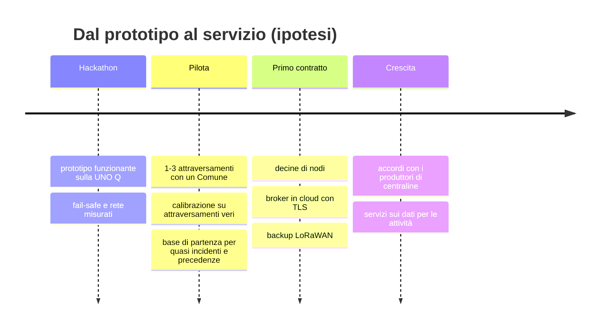

- **Prima un pilota**: pochi attraversamenti pericolosi (scuole, centri per anziani) scelti con l'ufficio traffico; si
  misura prima e dopo (quota di precedenze, quasi incidenti, verdi allungati concessi).
- **Canali**: gare pubbliche e piattaforme di acquisto della pubblica amministrazione; accordi con i produttori di
  semafori e centraline, così che l'interfaccia delle richieste sia integrata nelle loro centraline.
- **Finanziamenti**: linee di finanziamento per la sicurezza stradale dei Comuni *(da verificare caso per caso)*.

### 11.5 Indicatori

Quota di precedenze, quasi incidenti ogni 1.000 attraversamenti, verdi allungati concessi a pedoni vulnerabili, rossi
d'urgenza, tempo di funzionamento del nodo, **eventi persi (obiettivo 0)**, tempo di fail-safe (obiettivo < 0,5 s),
interventi dei tecnici evitati grazie alla diagnosi a distanza.

### 11.6 Rischi e contromisure

| Rischio | Contromisura |
|---|---|
| Autorizzazione ad agire sui semafori (Codice della Strada, certificazione delle centraline) | Solo richieste, dentro limiti che appartengono alla centralina certificata; fail-safe = ciclo normale |
| Privacy (GDPR, AI Act) | Nessuna immagine salvata, solo metadati, vista dal vivo dietro autenticazione e spegnibile; nessuna identificazione biometrica |
| Falsi allarmi o mancati rilevamenti | Regola esplicita con i motivi registrati; degrado controllato; secondo percorso di sicurezza non visivo (PIR/ToF) previsto |
| Vandalismo, furto | Accelerometro antifurto, eventi di manomissione verso la centrale, case |
| Meteo, notte | Autodiagnosi della camera, termocamera opzionale, sensori per l'appannamento (umidità) |
| Connettività | Decisioni offline, store and forward, radio di backup |
| Responsabilità | MDGB non toglie mai una protezione che esiste oggi; ogni decisione ha un motivo registrato |

---

## 12. Roadmap

| Area | Prossimi passi |
|---|---|
| AI | Calibrazione sull'attraversamento vero; classificatore degli ausili (carrozzina, deambulatore, passeggino); termocamera sul sensore vero; rilevamento migliore di veicoli lontani e bici |
| Firmware | Strip e ring LED, LCD e OLED; secondo percorso di sicurezza (PIR, ToF); monitoraggio della lampada (sensore di corrente); watchdog hardware |
| Comunicazioni | Broker in cloud con TLS mutuo; backup LoRaWAN con il watchdog `DEAD`; aggiornamento del contratto v1 (`tech`, `veh_red_now`, limite di 238 byte del Bridge) |
| Dati | Previsione dei flussi pedonali (lavoro in corso sul branch `paolo/forecast-flusso-pedonale`) |
| Prodotto | Case, alimentazione con batteria tampone, guida all'installazione, HTTPS per la pagina del tecnico |
| Extra | V2X: "pedone nascosto a X m" trasmesso ai veicoli |

---

## 13. Scaletta del pitch

Una struttura possibile in 10 slide, costruita su questo documento:

1. **Aggancio**: 470 pedoni morti in Italia nel 2024; i più esposti sono quelli a cui serve più tempo (§2).
2. **Il problema**: attraversamenti tarati su chi cammina a velocità media, sensori di presenza che non capiscono (§2).
3. **MDGB**: un guardiano sul semaforo che c'è già (§3, schema dell'idea).
4. **Demo dal vivo**: pedone anziano + auto veloce, poi animale libero contro cane al guinzaglio (§6.4, §7.6).
5. **Prima la sicurezza**: richieste entro i limiti, fail-safe in 485 ms (§6.3, §6.5).
6. **Privacy fin dal progetto**: nessuna immagine salvata, solo metadati, tecnico dietro badge + login (§3, §8.8).
7. **Non perde dati**: rete tagliata, backup Bluetooth, 0 eventi persi (§6.7).
8. **Sotto il cofano**: AI locale a 9 FPS su una Arduino UNO Q, regola esplicita (§7).
9. **Business**: aggiunta al semaforo esistente contro nuovi attraversamenti smart, fonti di ricavo, pilota (§11).
10. **Team e prossimi passi** (§12).

---

## 14. Glossario, mappa del repository, fonti

### Glossario

| Termine | Significato |
|---|---|
| C1…C5 | I messaggi tra le parti, definiti in [`docs/CONTRACTS.md`](CONTRACTS.md) |
| Fail-safe | Comportamento senza la visione: ciclo normale (con semaforo) o giallo lampeggiante (senza semaforo) |
| Heartbeat | Messaggio ogni 100 ms che dice "la visione è viva" |
| TTC | Tempo alla collisione: distanza / velocità |
| PET | Post-encroachment time: tempo tra il passaggio di due utenti dallo stesso punto |
| `d_stop` | Distanza che serve a un veicolo per fermarsi |
| `T_need` | Tempo che serve a un pedone per attraversare |
| Quota di precedenze | Parte dei veicoli che rallentano per un pedone in attesa |
| Store and forward | Salvare ogni evento prima di inviarlo, cancellarlo solo dopo la conferma |
| Bridge | Il collegamento RPC tra Linux e il microcontrollore della UNO Q |
| App Lab | L'ambiente di Arduino per le app che uniscono uno sketch e Python sulla UNO Q |

### Mappa del repository

| Percorso | Cosa | Owner |
|---|---|---|
| [`ai/`](../ai/README.md) | visione, regola, pagina del tecnico | Paolo Malugani |
| [`firmware/`](../firmware/unoq_panel/README.md) | app di App Lab, sketch | Salvatore Gullotta |
| [`comms/`](../comms/README.md) | nodo di rete | Lorenzo Dragoni |
| [`app/`](../app/README.md) | app della centrale | Lorenzo Dragoni |
| [`hardware/`](../hardware/BOM.md) | componenti, alimentazione | Kuzey Bicher |
| [`docs/`](CONTRACTS.md) | contratti, logo, questo documento; traduzioni in inglese in [`docs/en/`](en/README.md) | tutti |

### Fonti

- ISTAT e ACI, incidenti stradali 2024: [comunicato ACI](https://aci.gov.it/comunicati-stampa/aci-istat-gli-incidenti-stradali-2024-nelle-107-province-italiane/),
  [dati provinciali ISTAT 2024 (PDF)](https://www.istat.it/wp-content/uploads/2025/10/CS_Incidenti-stradali_provinciali_Anno-2024.pdf).
- Costi degli attraversamenti smart: vedi §11.3.
- Brief della sfida: [`docs/Transcription.txt`](Transcription.txt). Specifica tecnica:
  [`PROMPT_SMART_CROSSING.md`](../PROMPT_SMART_CROSSING.md).
- Zhang, Z. (2000), *A flexible new technique for camera calibration*, IEEE TPAMI.
